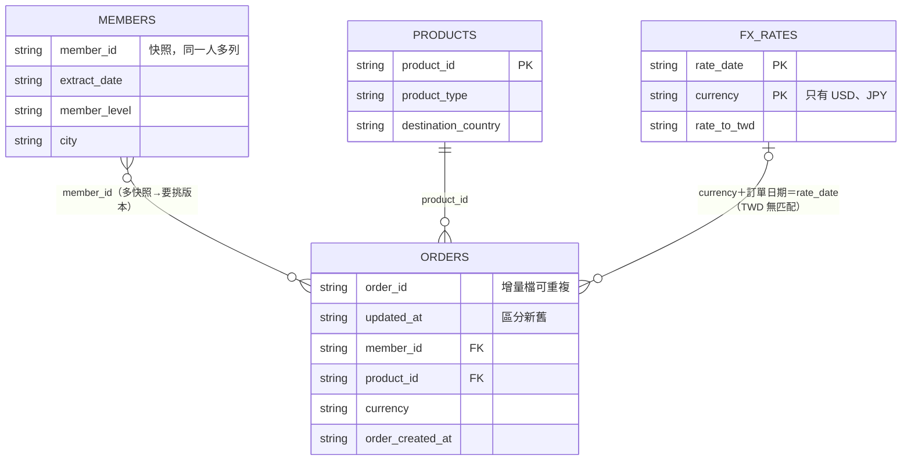

# Dataset 筆記

`candidate_package/dataset/` 有 7 個 CSV：訂單（1 份全量＋3 份每日增量）、會員、產品、匯率。

| 檔案 | 一句話 |
|---|---|
| orders_base.csv | 訂單初始全量，100,040 列 |
| orders_incremental_day1~3.csv | 每日增量，每列是一次訂單變更，同一張單可能多列 |
| members.csv | 會員快照，同一會員可能有多個 extract_date |
| products.csv | 產品主檔，300 個產品 |
| fx_rates.csv | 每日匯率，只有 USD、JPY（沒有 TWD） |

## 表之間怎麼連

- orders → members：用 `member_id`。members 有多個快照，要依訂單日期挑對應的版本，不能直接 join，否則一對多。
- orders → products：用 `product_id`。
- orders → fx_rates：用 `currency` ＋ 訂單日期 = `rate_date`。fx 只有 USD、JPY 兩種幣別，TWD 訂單不需要換算，也查不到匯率。

## 往下讀

- [dictionary.md](dictionary.md)：每個欄位的官方說明與實際觀察到的值、Part B 已驗證的事實。
- [incremental.md](incremental.md)：增量檔是不是訂單的 log、`updated_at` 的分布疑問。
