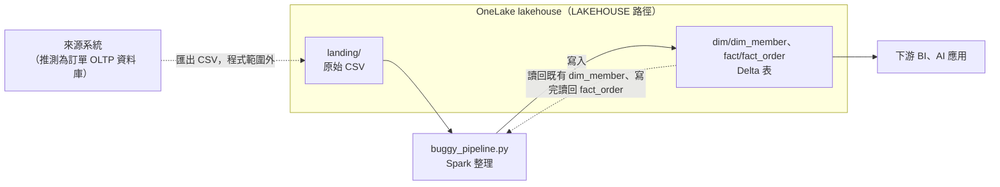

# buggy_pipeline.py 在資料流中的位置

回到入口：[README.md](README.md)｜正式報告：[../../part_b/code-review.md](../../part_b/code-review.md)

理解用的背景：程式讀寫哪些位置、各步驟碰到哪些表。報告只留 6 步流程圖。

## 資料流位置

依據是常數 `LAKEHOUSE = "abfss://lakehouse@onelake`：原始 CSV 和 Delta 表都放在同一個 OneLake lakehouse 底下，差別只在 `landing/` 是原檔、`dim/`、`fact/` 是 Delta 表（`format("delta")`）。程式讀 `landing/` 的 CSV（`load_sources()` 的 `f"{LAKEHOUSE}/landing/`），也讀既有的 Delta 表：`update_dim_member()` 先讀既有的 `dim_member` 再改寫（#6 的成因），`write_fact()` 寫完再讀回 `fact_order`。CSV 由哪個系統匯出，程式與題目都沒有說明，上圖的來源是推測。

## 各步驟讀寫哪些表

| 步驟 | 函式 | 讀 | 寫 |
|---|---|---|---|
| 1 | `load_sources` | `landing/` 下的 4 個 CSV | — |
| 2 | `clean_orders` | 當日增量訂單 | — |
| 3 | `convert_currency` | 訂單＋`fx_rates` | — |
| 4 | `update_dim_member` | `members`＋既有的 `dim/dim_member` | `dim/dim_member` |
| 5 | `build_fact` | 步驟 3 的結果＋`members`、`products` | — |
| 6 | `write_fact` | 步驟 5 的結果 | `fact/fact_order` |
