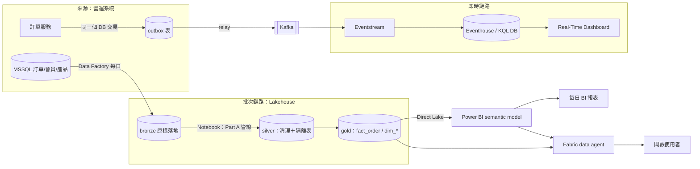

# 架構草圖 v1（查證前）

- 狀態：中間產物。C2 Fabric 查證完成**之前**畫的，只依規劃（`.claude/work/part-c.md`）各題的建議選項
- 用途：留下「查證前的直覺版本」，之後和 v2 比較，看查證改了什麼
- 所有選擇都是〔AI 暫定，待使用者確認〕

## v1 的已知疑點（等查證回答）
1. Eventstream 能不能直接讀 Kafka？還是要用 custom endpoint？
2. Eventhouse 的資料能不能同時給批次那邊用（OneLake availability）？
3. data agent 能不能讀 semantic model？如果不能，語意層放 semantic model 對問數沒有幫助
4. data agent 用誰的身分查？決定權限要在哪一層設
5. 即時鏈路沒有處理撞號與晚到事件，數字一定會和日報不同（Part A：撞號每天約 600 筆）
