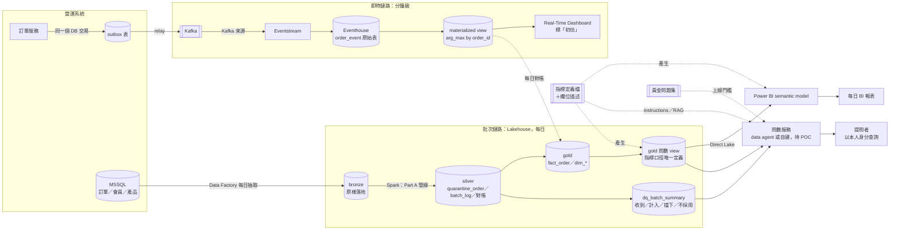

# 架構圖 v2（查證後，寫進 `part_c/README.md` 第 1 節的版本）

- 狀態：中間產物的存檔；正本在 `part_c/README.md`。所有選擇仍是〔AI 暫定，待使用者確認〕
- 和 v1（`architecture-v1.md`）的差別，每一項都來自 C2 查證或 Part A 證據：
  1. **Eventhouse 拆成原始表＋materialized view**：Eventstream 是 at-least-once 且沒有去重運算子（F1-11），用 `arg_max by order_id` 取最新（F2-8）。v1 只畫一個 Eventhouse 方塊，沒處理重送
  2. **儀表板標「初估」，加一條「每日對帳」虛線**：即時層不處理撞號（E4），數字和日報一定有差（Q5）
  3. **加 gold 問數 view、指標定義檔**：data agent 查 semantic model 時用不了 instructions 與 example queries（F6-6、F6-8），口徑改放 view（ADR-08）。v1 把 semantic model 當問數入口
  4. **問數服務改成「data agent 或自建，待 POC」**：data agent 不支援非英文（F7-8）
  5. **加 `dq_batch_summary` 與黃金問題集**：Text-to-SQL 配套（第 4 節）要在圖上看得到
  6. **semantic model 改接問數 view，不直接接 gold 表**：讓報表和問數讀同一份口徑

