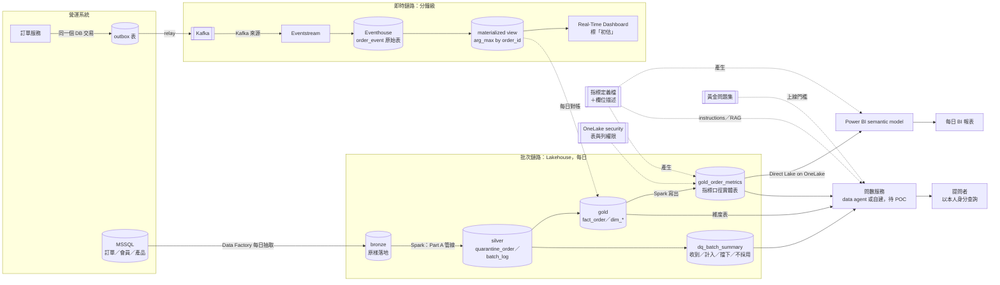

# 架構圖 v4（2026-10-24；2026-10-26 起被 v5 取代）

- 狀態：中間產物存檔；正本在 `part_c/README.md`。所有選擇仍是〔AI 暫定，待使用者確認〕
- 和 v3（`architecture-v3.md`）的差別：加一條 `GOLD -->|維度表| QA`。驗收 agent 指出 6.3 授權問數讀維度表、例句「各通路」也要用到維度表，但 v3 圖上只有指標表連到問數服務

