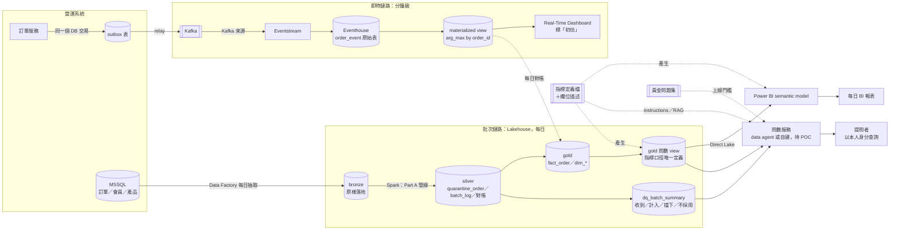

# README 第一版快照（審查前）

- 存檔用途：對照第 1 輪審查（`review-round1.md`）改了什麼；正本是 `part_c/README.md`
- 2026-10-24 依文件規則（章節編號從 1 開始）把快照內的章節編號與節號引用全部加 1（原 0～8 → 1～9、原 3.1 → 4.1，依此類推），其餘內容未動。`review-round1.md` 引用的是原編號

## 目錄
- [1. 前提與假設〔AI 產出〕](#1-前提與假設ai-產出)
- [2. 架構圖〔AI 產出〕](#2-架構圖ai-產出)
- [3. 元件與分層職責〔AI 產出〕](#3-元件與分層職責ai-產出)
- [4. 關鍵取捨〔AI 產出〕](#4-關鍵取捨ai-產出)
  - [4.1 批次層用 Lakehouse，不用 Warehouse（ADR-06）](#41-批次層用-lakehouse不用-warehouseadr-06)
  - [4.2 即時鏈路用 Eventstream → Eventhouse，不用微批次寫 Lakehouse（ADR-07）](#42-即時鏈路用-eventstream--eventhouse不用微批次寫-lakehouseadr-07)
  - [4.3 語意層：口徑放 gold view，semantic model 建在 view 上（ADR-08）](#43-語意層口徑放-gold-viewsemantic-model-建在-view-上adr-08)
- [5. 讓 Text-to-SQL 回答可信的配套〔AI 產出〕](#5-讓-text-to-sql-回答可信的配套ai-產出)
  - [5.1 語意層](#51-語意層)
  - [5.2 元資料](#52-元資料)
  - [5.3 權限](#53-權限)
  - [5.4 評估](#54-評估)
- [6. 從 Part A 延續的設計依據〔AI 產出〕](#6-從-part-a-延續的設計依據ai-產出)
- [7. 給上游的改善建議〔使用者判斷〕](#7-給上游的改善建議使用者判斷)
- [8. 未驗證事項與限制〔AI 產出〕](#8-未驗證事項與限制ai-產出)
- [9. AI 與使用者分工總述〔AI 產出〕](#9-ai-與使用者分工總述ai-產出)

---

# Part C｜Microsoft Fabric 架構設計：日批 BI、分鐘級儀表板、Text-to-SQL 問數

> **第一版草稿（2026-10-19）**：作者不在場時由 AI 依規劃與官方文件查證寫成，所有方向選擇都是〔AI 暫定，待使用者確認〕，作者尚未逐題確認。製作過程見 `../notes/part_c/process.md`。

**歸屬標註說明**（題目要求 4）：每個 `##` 標一種
- 〔AI 產出〕：AI 寫的，作者還沒改
- 〔AI 產出，使用者修改〕：AI 起草，作者改過內容或做了選擇
- 〔使用者判斷〕：作者自己的經驗判斷，AI 只整理文字

**證據編號**：`F` 開頭是 Fabric 官方文件查證（`../notes/part_c/fabric-facts.md`，每條附 learn.microsoft.com 連結與原文）；`E` 開頭是 Part A 的證據（`../notes/part_c/part-a-evidence.md`，每條附出處）。

## 1. 前提與假設〔AI 產出〕
| 項目 | 假設 | 依據 |
|---|---|---|
| 來源系統 | 訂單、會員、產品在營運 MSSQL；訂單服務可以改程式，加 outbox 表 | 題目「延續 Part A 的訂單域」；outbox 是作者在 Part A 討論提出的素材（第 7 節） |
| 批次量 | demo 資料 base 約 10 萬張、每天約 4,600 列增量；正式環境量級未知 | E2、E3 |
| 即時延遲目標 | 訂單狀態變動後 1～5 分鐘內反映在儀表板 | 題目「分鐘級」 |
| 問數的使用者 | 內部業務與營運人員，以**中文**提問 | 雄獅為台灣公司（假設） |
| 權威數字 | 每日批次的 gold 是唯一權威；即時數字是初估 | Q5（`../notes/part_c/tentative-decisions.md`） |
| 正式環境補 bronze | 補：上游原始檔原樣落地，可重算、可回查撞號 | Q2；Part A 本機沒有 bronze 是因為原始 CSV 就在 repo 裡（E7） |

## 2. 架構圖〔AI 產出〕

三條路徑走一遍：
- **一筆訂單事件**：訂單服務在同一個交易寫訂單與 outbox → relay 送 Kafka → Eventstream 收進 Eventhouse 原始表 → materialized view 取這張單最新狀態 → 儀表板偵測到新資料自動更新（F3-2）
- **每日批次**：Data Factory 把 MSSQL 前一天的資料原樣寫進 bronze → Part A 管線清理、隔離、對帳、寫 gold → 寫完後才 refresh semantic model（F5-4）→ 報表看到完整的一天
- **一個問題**：「上個月各通路的淨營收？」→ 問數服務讀指標定義，知道淨營收是 `net_amount_twd`、要排除疑似 ×1000 的單 → 對 gold 問數 view 產生 SQL，以提問者身分執行（F7-4）→ 回答附「這個月有 N 筆訂單被擋下未計入」（讀 `dq_batch_summary`）

## 3. 元件與分層職責〔AI 產出〕
| 元件 | 職責 | 為了哪個需求 |
|---|---|---|
| outbox＋relay＋Kafka | 訂單狀態變動和事件在同一個交易產生，不漏不多；Kafka 是 at-least-once，重送靠下游處理 | 即時 |
| Eventstream | 從 Kafka 收事件送進 Eventhouse（F1-1）；傳遞是 at-least-once（F1-11） | 即時 |
| Eventhouse 原始表＋materialized view | 原始表只 append；view 用 `arg_max(updated_at, *) by order_id` 取每張單最新狀態，擋掉重送與晚到的舊狀態（F2-8、E5） | 即時 |
| Real-Time Dashboard | 直接用 KQL 查 view，偵測到新資料就更新（F3-1、F3-2）；畫面標「初估，以次日日報為準」 | 即時 |
| Data Factory 每日抽取 | 把 MSSQL 前一天的變動抽成檔案落 bronze | 日批 |
| bronze | 原樣保存上游資料，規則改了能重算、撞號能回查原件 | 日批、問數（可追溯） |
| silver（Part A 管線） | 合約檢查、撞號與晚到處理、隔離表、每批對帳；冪等重跑（ADR-02～05） | 日批、問數（可信） |
| gold（fact／dim） | 一張訂單一列最新狀態（ADR-04）、會員 SCD2、產品、日期 | 日批、問數 |
| gold 問數 view | 指標口徑的唯一定義（ADR-08）：折扣前後、排除疑似 ×1000、台北日、是否已出發 | 日批、問數 |
| dq_batch_summary | 從 `batch_log` 與對帳結果整理每批「收到＝計入＋擋下＋不採用」（E15） | 問數（回答能說明排除了什麼） |
| semantic model（Direct Lake） | 建在問數 view 上，只做加總與切片，不自己加篩選條件 | 日批 |
| 指標定義檔＋欄位描述 | 一份機器可讀的定義，產生 view 註解、semantic model 描述、問數的 instructions | 問數、日批 |
| 問數服務 | 自然語言 → SQL → 以提問者身分執行；工具待 POC（Q7） | 問數 |
| 黃金問題集 | 上線門檻與回歸測試 | 問數 |

## 4. 關鍵取捨〔AI 產出〕
三個取捨的選項、事實與後果寫在 ADR；這裡只摘要。**三題的判斷都是〔AI 暫定，待使用者確認〕**，作者確認後改寫成自己的判斷。

### 4.1 批次層用 Lakehouse，不用 Warehouse（ADR-06）
- **選項**：全 Lakehouse／gold 放 Warehouse／全 Warehouse
- **關鍵事實**：Warehouse 的優勢是 T-SQL 寫入與多表交易（F4-4），但鎖是表層級（F4-5）；Lakehouse 的 SQL endpoint 唯讀（F4-1），寫入用 Spark
- **暫定判斷**：全 Lakehouse。Part A 的正確性靠「每批冪等寫入＋time travel 重跑」（ADR-05），不靠多表交易；換 Warehouse 要重寫已驗證的管線，換不到需要的東西
- **代價**：SQL endpoint 同步有延遲，正常 1 分鐘內（F4-6）；time travel 在 Fabric 上未實測

### 4.2 即時鏈路用 Eventstream → Eventhouse，不用微批次寫 Lakehouse（ADR-07）
- **選項**：Eventhouse＋Real-Time Dashboard／Spark Streaming 寫 Lakehouse／Eventstream 直接寫 Lakehouse
- **關鍵事實**：Eventhouse 資料要給 Lakehouse 那邊讀，延遲最少 5 分鐘、預設最多 3 小時（F2-2），所以分鐘級儀表板必須直查 Eventhouse；Spark 串流作業 retry 有 90 天上限，要人工重啟（F10-3）
- **暫定判斷**：Eventhouse。它是三個選項中唯一有官方文件支持「寫入後秒級可查、自動更新」的組合
- **代價**：去重取最新的規則要用 KQL 再寫一次，和 Part A 的 PySpark 是兩份。用「即時標初估、以日報為準、每天對帳」控制（Q5）。作者若不熟 KQL，選 Spark 微批次是正當取捨

### 4.3 語意層：口徑放 gold view，semantic model 建在 view 上（ADR-08）
- **選項**：全放 semantic model／全放 gold view／口徑放 view、加總切片放 semantic model
- **關鍵事實**：data agent 查 semantic model 時忽略 agent instructions、不支援 example queries（F6-6、F6-8），能用的 Prep data for AI 是 Preview（F6-3）；查 Lakehouse 時兩者都能用（F7-6、F7-7）
- **暫定判斷**：口徑放 gold view。Part A 找到的錯誤都是**口徑**錯：折扣前後（E8）、疑似 ×1000 的 40 張單佔營收 28.09%（E9）、completed 不等於已出團（E11）。口徑放在報表與問數都讀得到的地方，只有一份
- **代價**：要守住「semantic model 量值不自己加篩選」，用回歸測試比對兩邊數字

## 5. 讓 Text-to-SQL 回答可信的配套〔AI 產出〕
每項寫「建什麼」與「擋哪種錯」；每類最多三項。

### 5.1 語意層
| 建什麼 | 擋哪種錯 | 連回 Part A |
|---|---|---|
| **指標定義檔**（`metrics.yaml`）：每個指標一筆，寫名稱、同義詞、口徑（用哪個金額欄、排除哪些單、用哪個日期）、對應 SQL；由它產生 view 註解、semantic model 描述、問數 instructions | 同一個「營收」在報表和問數算法不同 | E8、E9 |
| **gold 問數 view**：例如 `v_order_revenue`，每張單一列，帶 `gross_amount_twd`、`net_amount_twd`、`is_amount_suspect`、`order_date_taipei`、`has_departed` | LLM 自己挑錯金額欄、忘了排除疑似 ×1000、用 UTC 日期分組 | E8、E9、E10 |
| **易混名詞表**：寫進 instructions，例如「已完成（completed）≠ 已出團，問出團要用 `has_departed`」「營收預設折扣前」 | 字面意思對、業務意思錯 | E11 |

### 5.2 元資料
| 建什麼 | 擋哪種錯 | 連回 Part A |
|---|---|---|
| **欄位描述**：從 `model.md` 欄位表與 `contracts.py` 的值域（E16）產生，寫單位、幣別、時區、允許值；掛在 view 欄位上 | 把原幣別當台幣加總；把 order_status 拼錯或猜值 | E13、E16 |
| **`dq_batch_summary` 表**：每批收到、計入、擋下、不採用的筆數與資料截止時間；問數回答時附上 | 回答看起來精確，其實有幾百筆被擋下或資料還沒到齊 | E6、E15 |
| **已知限制註記**：寫進 instructions，例如「會員等級是月快照，兩次快照間的變動看不到」「6 月營收在 7/2 之後還會變」 | 對精度不夠的資料給出過度精確的答案 | E6、E12 |

### 5.3 權限
| 建什麼 | 擋哪種錯 | 依據 |
|---|---|---|
| **問數只開 gold 問數 view**：OneLake security 角色只授權這些表（F8-5）；data agent 只勾選這些表（F7-3） | LLM 查到隔離表或原始欄位的 -1、N/A，算出錯的數字 | E14、E18 |
| **以提問者本人身分查詢＋view 上的 RLS**：data agent 本來就用提問者的 Entra 身分（F7-4）。前提：提問者是 Viewer（F8-6），SQL endpoint 用 User identity 模式（F8-8、F8-9） | 問數成為繞過報表權限的後門 | F7-4、F8-6、F8-9 |
| **唯讀與結果大小上限**：data agent 只產生讀取查詢、最多 25 列（F7-5、F7-8）；自建時用唯讀帳號與 `TOP` 限制 | LLM 產生寫入語句或拉走整張表 | F7-5、F7-8 |

### 5.4 評估
| 建什麼 | 擋哪種錯 | 連回 Part A |
|---|---|---|
| **黃金問題集**：每題有中文問題、預期 SQL、預期答案；刻意收 Part A 的陷阱題（折扣前後、×1000、completed vs 出團、台北日） | 上線前不知道它會不會踩到已知的坑 | E8～E11 |
| **回歸測試**：指標定義、view、instructions、模型版本任一改動就重跑整份黃金問題集，低於門檻不上線（data agent 有 `evaluate_data_agent`，Preview，F7-12）；門檻〔待使用者定〕 | 改了一個定義，別的問題默默變錯 | 同上 |
| **上線後抽樣審查**：每週抽樣回答人工檢查，答錯的題目加進黃金問題集 | 黃金問題集沒涵蓋的新問法 | — |

**問數工具本身（Q7）〔AI 暫定，待使用者確認〕**：Fabric data agent 原生、以提問者身分查詢，但官方寫明**目前不支援非英文**（F7-8）。先用黃金問題集的中文題對 data agent 做 POC，過門檻就用它；不過就自建（LLM＋讀指標定義檔＋SQL 執行器），上面的配套兩種做法都用得上。

## 6. 從 Part A 延續的設計依據〔AI 產出〕
| Part A 的發現或決定 | 在 Part C 變成什麼 |
|---|---|
| ADR-01 選 PySpark＋Delta，因為正式環境在 Fabric（E19） | 批次層全 Lakehouse，管線直接搬（4.1） |
| ADR-02 來源介面＋schema 合約（E16） | 換成 MSSQL 來源只換讀取層；合約的欄名、型別、值域變成問數的欄位描述（5.2） |
| ADR-03 撞號每天約 600 筆（E4）、L4 晚到 25 張（E5） | 即時層至少要取最新狀態；撞號只能日批處理，所以即時標初估（4.2） |
| ADR-04 一張訂單一列存最新狀態，歷程不保存（E7） | 正式環境補 bronze；問數回答「現在的狀態」，不回答「狀態變化花幾天」 |
| ADR-05 time travel 重跑（E20） | 在 Fabric 上要實測，並設 VACUUM 保留期（第 8 節） |
| 對帳「收到＝計入＋擋下＋不採用」（E15） | `dq_batch_summary`，問數回答附排除筆數（5.2） |
| 會被問錯的定義（E8～E12） | 指標定義檔、問數 view、易混名詞表、黃金問題集的陷阱題（5.1、5.4） |

## 7. 給上游的改善建議〔使用者判斷〕
素材是作者在 Part A 討論時提出的（原始紀錄見 `.claude/work/part-c.md`「已收的素材（2026-10-18，Part A 討論）」），AI 只整理文字；兩項的取捨細節（Q10）仍〔待使用者確認〕。
- **訂單事件：Kafka 放在 outbox 後面**。訂單服務在寫訂單的同一個資料庫交易裡寫一列 outbox，relay 再把 outbox 送進 Kafka，所以「訂單寫了、事件沒送」不會發生。Kafka 預設 at-least-once，重送擋不掉，所以每個事件在建立時就產生唯一鍵，下游用這個鍵冪等寫入（即時層的 `arg_max` 與日批的 MERGE 都是）
- **會員變動時間**：上游現在只給每月快照，SCD2 的生效日只能用快照日近似（E12）。三種改法：會員表加 `updated_at`（只知道最後一次變動）、另建等級異動紀錄表（每次變動一列附生效日）、或用 CDC（不用改上游程式）。〔AI 暫定，待使用者確認〕：異動紀錄表為主，不能改上游時用 CDC

## 8. 未驗證事項與限制〔AI 產出〕
- **Fabric 上未實測**：本設計沒有在 Fabric 上跑過；Part A 只在本機用 PySpark＋Delta 模擬 Lakehouse。Delta time travel 在 Fabric 的行為依格式推論（ADR-05）
- **文件狀態有矛盾或未明確 GA**：data agent 的 concept 頁寫 GA，但 AI 功能狀態總表把它和 Preview 功能合併成一列；Direct Lake on OneLake 與 OneLake security 只能說「Learn 現行文件未標 Preview」（fabric-facts「未查到或文件矛盾」第 1～3 條）
- **Preview 功能**：Prep data for AI（F6-3）、data agent 評估 SDK（F7-12）、Copilot Studio 整合（F7-10）
- **分鐘級沒有實測**：Real-Time Dashboard 的更新間隔下限，官方文件沒給數字（未查到第 5 條）
- **中文問數**：data agent 官方不支援非英文（F7-8），實際效果要 POC
- **即時層不處理撞號**：即時數字和日報一定有差，靠每日對帳說明差異，不保證一致

## 9. AI 與使用者分工總述〔AI 產出〕
〔待使用者撰寫 3～5 句〕。素材：
- 作者提供：outbox＋Kafka、會員變動時間的上游建議（第 7 節）
- AI 產出：規劃骨架（opus Plan agent）、Fabric 官方文件查證（研究 subagent，85 條附連結）、Q1～Q10 暫定、ADR-06～08 草稿、本文件第一版
- 尚待作者：確認或推翻 Q1～Q10、撰寫 ADR-06～08 的決定與理由、走查架構圖三條路徑
