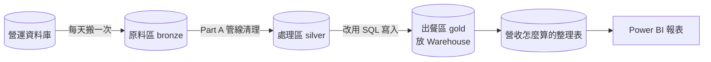
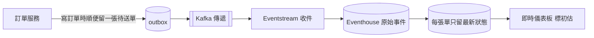
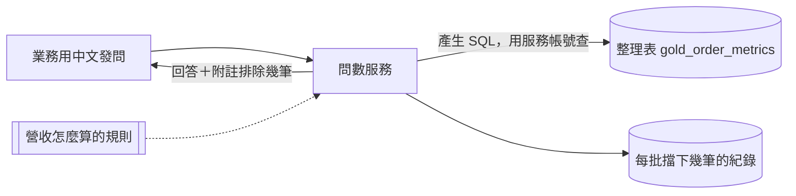

# 架構圖的三條路線：白話說明

- 用途：給作者看懂 `part_c/README.md` 第 3 節架構圖用。README 只有三行精簡版，這裡逐步拆開，說明每一步做什麼、為什麼需要、可能出什麼錯
- 狀態：〔AI 產出〕，依目前的設計寫成。10 個方向題（Q1～Q10）中，作者已定案 Q1～Q4、Q7、Q10，Q5、Q6、Q8、Q9 採用 AI 建議，清單見 `tentative-decisions.md`；和這三條路直接相關的是 Q1（即時資料從哪來）、Q4（即時路線用什麼做）、Q7（問數用什麼工具）。確認後若設計改了，這份要跟著改
- 看不懂的名詞（撞號、晚到、Kafka、Eventhouse 等）見附錄 A
- 比喻：用餐廳比喻資料平台。原始資料是食材，清理是廚房，整理好的表是上桌的菜

## 目錄
- [1. 總覽](#1-總覽)
- [2. 日報路線（正式宴席：慢慢做、每道菜都檢查）](#2-日報路線正式宴席慢慢做每道菜都檢查)
- [3. 即時路線（外帶窗口：先給你，精緻度差一點）](#3-即時路線外帶窗口先給你精緻度差一點)
- [4. 問數路線（AI 服務生：要先給它守則，才不會亂答）](#4-問數路線ai-服務生要先給它守則才不會亂答)
- [5. 走查時可以自問的三個問題](#5-走查時可以自問的三個問題)
- [A. 名詞](#a-名詞)

## 1. 總覽

| 路線 | 給誰 | 要什麼 | 多快 | 圖上的區塊 |
|---|---|---|---|---|
| 日報 | 看 Power BI 的主管 | 準 | 隔天 | 「批次鏈路：Lakehouse，每日」 |
| 即時 | 看儀表板的營運人員 | 快 | 幾分鐘 | 「即時鏈路：分鐘級」 |
| 問數 | 用中文問問題的業務 | 答得對、說得出依據 | 隨問隨答 | 右下角「問數服務」與它周圍的虛線 |

**三條路的關係**：日報是唯一的正確答案。即時是「初估」，每天和日報對帳一次。問數讀的是日報整理好的表。

## 2. 日報路線（正式宴席：慢慢做、每道菜都檢查）

| 步驟 | 發生什麼 | 為什麼需要 |
|---|---|---|
| 1. 每天搬一次 | Data Factory 把營運資料庫前一天的訂單變動，以及整張會員表，搬進 Fabric | 營運資料庫是給做生意用的，直接拿它做報表會拖慢訂單系統 |
| 2. 原料區（bronze） | 搬進來的資料原樣存一份，不做任何修改 | 規則改了可以重算；撞號要查證時有原件可對。上游的檔案不歸我們管，可能會被刪 |
| 3. 處理區（silver） | 跑 Part A 的管線：檢查欄位、擋撞號、處理晚到、算匯率、對帳 | 原始資料有問題（撞號每天約 600 筆；晚到的舊狀態 25 張；還有 60 張 6 月的新單 7/2 才送到），不清理就會算錯 |
| 4. 出餐區（gold，放 Warehouse） | 乾淨的訂單表、會員表、產品表；只有管線能寫，下游營運人員可以用 SQL 讀它、另建自己的彙總表 | 這是「正確答案」，報表和問數都從這裡拿。下游不能直接改它，否則下一批資料進來時，管線會拿被改過的資料比對而出錯（Q3 使用者定案） |
| 5. 整理表 `gold_order_metrics` | 每張訂單一列，先標好「折扣前後金額」「是不是異常金額」「台北的下單日」 | 「營收怎麼算」只寫在這一個地方，報表和 AI 才會算出同一個數字 |
| 6. Power BI 報表 | 讀整理表，做加總和圖表 | 全部寫完才更新報表，主管不會看到只更新一半的數字 |

**可能出的錯與防法**：管線跑到一半當掉 → Part A 已經做到「整批重跑，結果和沒當掉一樣」（ADR-05）。

## 3. 即時路線（外帶窗口：先給你，精緻度差一點）

| 步驟 | 發生什麼 | 為什麼需要 |
|---|---|---|
| 1. outbox | 訂單服務寫訂單時，在**同一次存檔**裡多寫一張「待送單」 | 保證「訂單存了、通知沒送」不會發生。這是作者在 Part A 提的做法 |
| 2. Kafka | 把待送單一筆一筆傳出去 | 專門負責可靠傳遞的工具。特性是「保證不漏，但可能重送」 |
| 3. Eventstream | Fabric 的收件口，把事件收進來，同時另存一份到日報路線的原料區（bronze） | Fabric 裡接 Kafka 的現成工具；另存一份是因為上游不保證能重給（Q2 使用者定案） |
| 4. Eventhouse 原始事件 | 每個事件都存一筆，只增加不修改 | 專門存「一直進來的資料」的資料庫，寫進去幾秒就查得到 |
| 5. 每張單只留最新狀態 | 同一張單收到多次，只留「狀態更新時間」（上游給的 `updated_at` 欄位）最新的那筆 | 擋掉重送，也擋掉「晚到的舊狀態」，例如先收到取消、才收到更早的付款。限制：同一張單兩筆的更新時間一樣、或上游時鐘不準時，留下的不一定是真的最新狀態；要上游給每筆事件帶遞增的版本號才能根治 |
| 6. 即時儀表板 | 有新資料進來就自動更新，畫面標「初估」 | 營運要幾分鐘內看到變化 |

**為什麼只能是「初估」**：撞號要拿歷史訂單來比對，即時路線來不及做，所以數字一定和日報有差。每天把兩邊的訂單數、金額對一次帳，說明差在哪。

**被否決的替代方案**（Q4 作者定案 Eventhouse：「多學 KQL，換到省心和秒級」）：不用 Eventhouse，改用 Spark 每分鐘處理一次、存進 Lakehouse。好處是不用學新語言 KQL；代價是要自己顧一個長期執行的程式，分鐘級也比較難保證。

## 4. 問數路線（AI 服務生：要先給它守則，才不會亂答）

| 步驟 | 發生什麼 | 為什麼需要 |
|---|---|---|
| 1. 發問 | 例如「上個月各通路的淨營收？」 | — |
| 2. 讀規則 | AI 先讀「營收怎麼算」的定義：淨營收用哪個欄位、哪些單要排除 | AI 最常錯的不是語法，是業務意思，例如折扣前後搞混、把「已完成」當「已出團」 |
| 3. 查整理表 | AI 寫 SQL 查 `gold_order_metrics`，用問數服務自己的帳號查，這個帳號只能讀整理好的表 | 看不到雜亂的原始資料；能用問數的人看到的範圍和報表相同（Q8 採用 AI 建議：先不分「誰看得到哪些訂單」） |
| 4. 附上擋下筆數 | 回答時附「這個月有 N 筆訂單被擋下沒算」 | 讓人知道數字背後排除了什麼，不會誤以為是全部 |
| 5. 上線前先考試 | 用一份「黃金問題集」測它，專收 Part A 的陷阱題，考過及格線才上線 | 上線前就知道它會不會踩已知的坑 |

**已定的事**：問數服務自己做（Q7 作者定案：「我偏好自己作」）。微軟現成的 data agent 官方寫明目前不支援非英文。

## 5. 走查時可以自問的三個問題

1. 這一步拿掉會怎樣？說不出來，代表這個元件可能不需要
2. 這一步出錯時，誰會發現？
3. 這一步需要我（或團隊）會什麼技術？

## A. 名詞

| 名詞 | 白話 |
|---|---|
| Part A | 本考題的第一部分：用 PySpark 寫的訂單清理管線。日報路線的「處理區」就是它 |
| ADR | 架構決策紀錄，一份檔記一個有取捨的決定。ADR-05 記的是「管線當掉時怎麼安全重跑」 |
| 撞號 | 新送來的訂單用了已經存在的訂單編號，但會員、金額、下單時間都不同，等於兩張不同的單撞了同一個號碼 |
| 晚到 | 資料比該到的時間晚送來。有兩種：舊狀態晚到（先收到取消、隔天才收到更早的付款），和新單晚到（6 月的單 7/2 才送來） |
| Data Factory | Fabric 裡負責排程、搬資料的工具 |
| Kafka | 專門可靠傳遞訊息的系統；保證不漏，但可能重送 |
| Eventstream | Fabric 的事件收件口，可以接 Kafka |
| Eventhouse | Fabric 裡專門存「持續進來的事件」的資料庫，寫進去幾秒就能查 |
| KQL | Eventhouse 的查詢語言，和 SQL 不同 |
| data agent | 微軟在 Fabric 提供的現成 AI 問數工具 |
