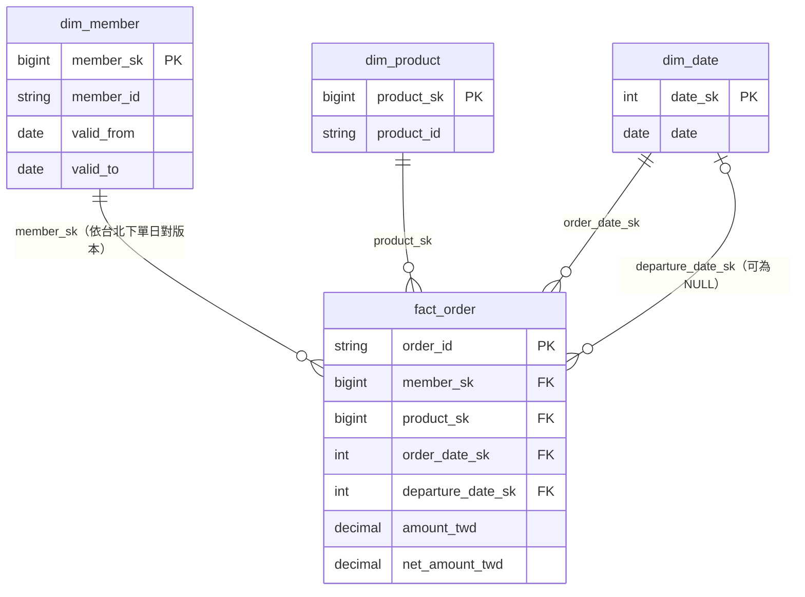

# A-1｜星型模型設計說明

本文件說明 Part A 資料倉的星型模型：一張事實表 `fact_order`、三張維度表 `dim_member`（SCD Type 2）、`dim_product`、`dim_date`。欄位與型別以程式為準（`pipeline/fact_order.py`、`pipeline/dim_member.py`、`pipeline/dims.py`、`pipeline/contracts.py`），文中數字都是實際執行量到的，量法見附錄。

**數字的量測階段**：除非另外註明，數字都是 base → day1 → day2 → day3 四批依序跑完（`run_all()`，HEAD 9f9d415，2026-10-26 實跑）之後，直接讀 Delta 表得到；量法與原始輸出見附錄 A。每批的對帳見 `README.md`「三天實跑的對帳」。

## 目錄

- [1. 模型圖](#1-模型圖)
- [2. 各表](#2-各表)
  - [2.1 fact_order](#21-fact_order)
  - [2.2 dim_member](#22-dim_member)
  - [2.3 dim_product](#23-dim_product)
  - [2.4 dim_date](#24-dim_date)
  - [2.5 fact_order 的 CHECK 約束](#25-fact_order-的-check-約束)
- [3. dim_member 的 SCD2 規則](#3-dim_member-的-scd2-規則)
- [4. fact 怎麼接維度](#4-fact-怎麼接維度)
- [5. 金額](#5-金額)
  - [5.1 排除待確認清單後的金額總和](#51-排除待確認清單後的金額總和)
- [6. 設計決策摘要](#6-設計決策摘要)
- [7. 已知限制](#7-已知限制)
- [附錄：量測方法與輸出](#附錄量測方法與輸出)
  - [A. 跑完四批並查 Delta 表](#a-跑完四批並查-delta-表)
  - [B. 原始 members.csv（duckdb，未經管線）](#b-原始-memberscsvduckdb未經管線)

## 1. 模型圖



`dim_date` 在 fact 上扮演兩個角色：下單日（`order_date_sk`）與出發日（`departure_date_sk`）。

## 2. 各表

| 表 | 粒度 | 代理鍵 | 自然鍵 | 寫入（MERGE key） | 特殊列 | 列數（四批跑完） |
|---|---|---|---|---|---|---|
| `fact_order` | 一張訂單一列，存最新狀態 | 無（用 order_id） | `order_id` | `order_id` | 無 | 112,010 |
| `dim_member` | 一位會員的一個版本 | `member_sk = xxhash64(member_id, valid_from)` | `member_id`＋`valid_from` | `member_sk` | 無（對不到會員的訂單進隔離表） | 8,772 |
| `dim_product` | 一個產品一列（Type 1） | `product_sk = xxhash64(product_id)` | `product_id` | `product_id` | 未知產品 -1 | 301（300＋1） |
| `dim_date` | 一天一列 | `date_sk`＝yyyymmdd 整數 | `date` | `date_sk` | 無 | 183（2026-05-01～2026-10-30） |

**為什麼代理鍵重跑穩定**：三張維度的代理鍵都由自然鍵用確定性函式算出（`xxhash64`、`date_format(..., "yyyyMMdd")`），不用 `row_number()` 或自增序號，所以重跑、換分區、換輸入順序，同一個自然鍵永遠得到同一個 sk，fact 上的外鍵不會失效。

**MERGE**：都走 `delta_io.merge_upsert()`（`whenMatchedUpdateAll()`＋`whenNotMatchedInsertAll()`，不刪列）。呼叫前 key 必須唯一，否則 Delta 會插入多列（Part B 的 E12）。fact_order 另外只在來源的 `updated_at` 比表內新時才覆寫，亂序送來的舊事件不會讓狀態倒退（`README.md`「增量處理策略」）。

### 2.1 fact_order

粒度：一張訂單一列，存最新狀態（ADR-04）。四批跑完 112,010 列（base 99,950、day1 4,000、day2 4,060、day3 4,000），`order_id` 112,010 個不重複。

| 欄位 | 型別 | 說明 |
|---|---|---|
| `order_id` | string | 自然鍵、MERGE key |
| `member_id` | string | 來源原值；撞號比對要用，也保留對不到維度時的原值 |
| `member_sk` | bigint | 依台北下單日對到的會員版本；一定對得到（對不到的訂單進隔離表，CHECK `member_sk IS NOT NULL`） |
| `product_id` | string | 來源原值 |
| `product_sk` | bigint | 對不到產品清單為 -1 |
| `order_date_sk` | int | 台北下單日，yyyymmdd |
| `departure_date_sk` | int | 出發日，yyyymmdd；出發日為空時為 NULL |
| `order_status` | string | 原值 |
| `channel` | string | 原值 |
| `quantity` | int | |
| `currency` | string | 原值（NTD 不改成 TWD） |
| `amount` | decimal(18,2) | 原幣別金額，折扣前（J10）；一定大於 0（負數在讀取檢查就擋下） |
| `fx_rate` | decimal(18,6) | 換算用匯率；TWD、NTD 為 1 |
| `amount_twd` | decimal(38,2) | `round(amount × fx_rate, 2)` |
| `coupon_discount` | decimal(18,2) | 折扣，台幣（官方 `candidate_package/README.md` 欄位說明寫 TWD），所以不換算；原值 -1 代表未知，轉 NULL |
| `net_amount_twd` | decimal(38,2) | 折扣後金額＝`amount_twd − coupon_discount`；coupon 為 NULL 時也是 NULL |
| `order_created_at` | timestamp | 解析後的下單時刻 |
| `updated_at` | timestamp | 解析後的更新時刻 |
| `batch_id` | string | 最後寫入這一列的批次（`base`、`day1`～`day3`） |

沒寫進 fact 的列進隔離表 `quarantine_order`（原始字串＋`reject_category`＋`reject_reasons`），不屬於星型模型本身，細節見 `pipeline/README.md`。四批對帳（依序 base／day1／day2／day3）：輸入 100,040／4,615／4,700／4,615＝寫進 fact 99,950／4,000／4,060／4,000＋隔離 90／615／615／615＋略過 0／0／25／0。base 的 90 列是負數金額 50（`contract`，V1）與重複 40（`duplicate`，V7）；增量的隔離是撞號（`collision`、`collision_existing`）與重送（`duplicate`），略過的 25 列是晚到的舊事件（`late_event`）。

金額人工確認清單 `amount_review`（疑似多乘 1,000、折扣大於金額）的訂單照原樣留在 fact，清單另存一張表，四批跑完 40 張（全在 base，都是疑似多乘 1,000）。也不屬於星型模型本身，用法見第 5.1 節。

### 2.2 dim_member

粒度：一位會員的一個版本（SCD Type 2，規則見第 3 節）。

| 欄位 | 型別 | 說明 |
|---|---|---|
| `member_sk` | bigint | `xxhash64(member_id, valid_from)` |
| `member_id` | string | 自然鍵 |
| `member_name` | string | Type 1 |
| `member_level` | string | Type 2；只接受 一般／銀卡／金卡／白金 |
| `city` | string | Type 2；`N/A` 轉 NULL |
| `birth_date` | date | Type 1；`1900-01-01` 轉 NULL |
| `register_date` | date | 第一次看到的值，之後不變 |
| `valid_from` | date | 版本開始日（含） |
| `valid_to` | date | 版本結束日（不含）；目前版本為 9999-12-31 |
| `is_current` | boolean | 是否為目前版本 |
| `last_seen_extract_date` | date | 這位會員已處理到哪一批快照，用來擋重送的舊快照 |

**沒有未知會員列**（和 dim_product 的 -1 不同）：訂單對不到會員版本時整列進訂單隔離表（`member_missing`），不落 -1，所以 fact 永遠不會指向未知會員，這一列沒有用處（使用者定：「在訂單重要度之後是會員資料 如果有未知會員資料在做客戶分析是一件困難的事 所以要有錯誤提醒修正data pipline」）。〔防護性設計：本資料 0 筆〕

**會員隔離表** `quarantine_member`：會員快照的違規列（等級不在清單、註冊日晚於快照日、格式錯誤）保留原始字串與原因，以快照日 `extract_date` 識別。不屬於星型模型本身，細節見 `pipeline/README.md`。壞列不參與建版本，不會蓋掉該會員上一個好版本。〔防護性設計：本資料 0 筆〕

四批跑完：8,000 位會員、8,772 個版本（7,228 位 1 版、772 位 2 版），目前版本 8,000 列；沒有 `member_sk = -1` 或 `member_id` 為 NULL 的列；會員隔離表 0 列。會員快照截止在 06-30，三份快照在 base 那批就處理完，之後三批沒有新快照，dim_member 不變。

### 2.3 dim_product

粒度：一個產品一列，Type 1（產品清單只有一份，不保留歷史）。

| 欄位 | 型別 | 說明 |
|---|---|---|
| `product_sk` | bigint | `xxhash64(product_id)` |
| `product_id` | string | 自然鍵、MERGE key |
| `product_name` | string | |
| `product_type` | string | |
| `destination_country` | string | |
| `destination_city` | string | |
| `trip_days` | int | |
| `base_price_twd` | decimal(18,2) | |
| `is_active` | boolean | 原值 `Y`→true、`N`→false，其他值→NULL（讓品質檢查抓得到） |

未知產品列：`product_sk = -1`、`product_id = 'UNKNOWN'`、`product_name = '未知產品'`，其餘 NULL。產品清單的 `product_id` 重複、或使用保留字 `UNKNOWN`，`build_dim_product()` 丟 `DuplicateKeyError` 整批停。

### 2.4 dim_date

粒度：一天一列。範圍不寫死，由傳入的訂單算出：下單日與出發日合起來的最早到最晚日期，中間不留缺日；之後每批只補新日期（取既有範圍與本批範圍的聯集）。

| 欄位 | 型別 | 說明 |
|---|---|---|
| `date_sk` | int | yyyymmdd，`date_sk()` 計算；fact 用同一個函式 |
| `date` | date | |
| `year` | int | |
| `quarter` | int | |
| `month` | int | |
| `day` | int | |
| `day_of_week` | int | ISO：週一＝1 … 週日＝7 |
| `is_weekend` | boolean | 週六、週日 |

沒有特殊列：下單日一定落在範圍內；出發日為空時 fact 的 `departure_date_sk` 是 NULL，不指向任何列。

### 2.5 fact_order 的 CHECK 約束

fact_order 建表時加 6 條 Delta CHECK 約束，只加在關鍵欄位，當最後一道防線：管線在讀取檢查與對維度時已經擋下這些值，約束擋的是 notebook 直接寫入、手動 `UPDATE` 這類繞過管線的寫入，違反時整次寫入失敗（使用者定：「Delta CHECK 是最後一道防線，擋得住繞過管線的寫入」）。〔防護性設計：本資料 0 筆〕

| 約束 | 條件（讀回表上的實際內容） |
|---|---|
| `order_id_not_null` | `order_id IS NOT NULL` |
| `amount_positive` | `amount > 0` |
| `coupon_discount_non_negative` | `coupon_discount IS NULL OR coupon_discount >= 0` |
| `order_status_valid` | `order_status IN ( 'created' , 'paid' , 'cancelled' , 'completed' )` |
| `currency_valid` | `currency IN ( 'TWD' , 'NTD' , 'USD' , 'JPY' )` |
| `member_sk_not_null` | `member_sk IS NOT NULL` |

狀態與幣別的清單由程式產生（`order_status.STATUSES`、`contracts.ORDER_CURRENCIES`），和讀取檢查用同一份。

## 3. dim_member 的 SCD2 規則

| 規則 | 內容 | 程式位置 |
|---|---|---|
| Type 2 欄位 | `member_level`、`city`：值變就開新版本 | `_versions()` 的 `changed` |
| Type 1 欄位 | `member_name`、`birth_date`：取最新已知值，覆寫該會員所有版本 | `_versions()` 的 `F.last(..., ignorenulls=True)` |
| 處理順序 | 依 `extract_date` 由舊到新；會員沒出現在某批就沿用前版；內容沒變不開版 | `_observations()`、`_versions()` |
| 第一版 `valid_from` | `register_date`（訂單可能早於第一次快照） | `F.when(F.col("_rn") == 1, F.col("register_date"))` |
| 之後各版 `valid_from` | 觀察到變動那一批的 `extract_date` | 同上的 `otherwise(F.col("obs_date"))` |
| `valid_to` | 下一版的 `valid_from`（不含當天）；目前版本 `CURRENT_VALID_TO = 9999-12-31` | `F.coalesce(next_from, F.lit(CURRENT_VALID_TO))` |
| 同日矛盾 | 同 `member_id`、同 `extract_date` 多列，取較高等級（一般＜銀卡＜金卡＜白金） | `_normalize()` 的 `_level_rank(F.col("member_level")).desc()` |
| 假值 | `city = 'N/A'`、`birth_date = 1900-01-01` 轉 NULL，且不蓋掉已知真實值 | `_normalize()`；`_versions()` 的 `F.last("city", ignorenulls=True)` |
| city 從 NULL 變真實值 | 算變動、開新版本，不回填舊版本 | `_versions()` |
| 重送舊快照 | `extract_date ≤ last_seen_extract_date` 的列跳過 | `_fresh_snapshots()` |
| 違規列 | 等級不在清單、`register_date` 晚於 `extract_date` → rejected | `_extra_checks()` |

原始 `members.csv` 的量測（duckdb 直接查 CSV，未經管線）：三批快照 04-30 有 8,030 列、05-31 有 459 列、06-30 有 502 列；同日矛盾 30 位（全在 04-30）；`city = 'N/A'` 71 列；`birth_date = 1900-01-01` 81 列；同時出現在 05-31 與 06-30 的會員 0 位。四批跑完會員隔離表 0 列。

**例子：M003364（等級變動）**

原始快照：

| extract_date | member_level | city |
|---|---|---|
| 2026-04-30 | 金卡 | 宜蘭縣 |
| 2026-05-31 | 白金 | 宜蘭縣 |

四批跑完後的 dim_member：

| member_sk | member_level | city | valid_from | valid_to | is_current |
|---|---|---|---|---|---|
| -3557865958876548194 | 金卡 | 宜蘭縣 | 2021-04-03（register_date） | 2026-05-31 | false |
| -7297393746572952954 | 白金 | 宜蘭縣 | 2026-05-31（extract_date） | 9999-12-31 | true |

這位會員在 fact 的 12 張單：下單日 05-13、05-19（2 張）對到金卡版本；06-16～06-30 的 6 張，以及增量寫入的 07-02（2 張，day2）、07-03（1 張，day3）對到白金版本。第一版從 register_date 開始，所以 04-30 以前的訂單也對得到版本。

**例子：M002261（city 從 NULL 變真實值）**：第一版 city 為 NULL（原值 `N/A`），valid 2015-04-12～2026-06-30；06-30 快照出現「台中市」，開第二版 2026-06-30～9999-12-31，舊版本維持 NULL。

## 4. fact 怎麼接維度

下單日 `_order_date = to_date(parse_source_timestamp(order_created_at))`。SparkSession 時區固定 `Asia/Taipei`，所以這是台北日期：`+08:00` 照標記、`Z` 當 UTC 換算、無時區標記當台北時間。

| 外鍵 | 怎麼取 | 對不到時 | 四批跑完落 -1／NULL 的筆數 |
|---|---|---|---|
| `member_sk` | `resolve_member_sk()`：left join，條件 `member_id` 相同且 `valid_from <= _order_date < valid_to` | 整張訂單進隔離表（`member_missing`），不落 -1（member_id 不存在、或下單日早於第一版 valid_from）〔防護性設計：本資料 0 筆〕 | 0 |
| `product_sk` | `resolve_product_sk()`：以 `product_id` left join dim_product | -1 | 120（全在 base） |
| `order_date_sk` | `date_sk(F.col("_order_date"))` | 不會發生（dim_date 範圍由訂單算出） | — |
| `departure_date_sk` | `date_sk(F.col("departure_date"))` | `departure_date` 為空時 sk 為 NULL，代表「沒有出發日」（例如票券），不是未知日期 | 0 列為 NULL |

- 版本區間互不重疊，每張單最多對到一版，left join 不會讓 fact 列數變多。
- fact 端不直接呼叫 `product_sk()` 算 hash：清單外的 id 會算出懸空外鍵，而且 `xxhash64(NULL)` 是 42 不是 NULL。
- `resolve_member_sk()` 必須拿整張 dim_member（`write_dim_member()` 回傳的 `table`），只給部分會員時其他會員的單會對不到而被隔離。
- 產品和會員對不到時的處理刻意不同：產品可能隨時間下架消失，所以 V6 保留訂單、落 -1；會員是客戶分析的主體，對不到代表管線或上游有錯，用隔離表提醒修正。

## 5. 金額

| 欄位 | 來源 |
|---|---|
| `amount` | 來源原值，原幣別 |
| `currency` | 來源原值（TWD、USD、JPY、NTD） |
| `fx_rate` | 台北下單日當天、該幣別的 `rate_to_twd`；`TWD_PEGGED_CURRENCIES = ("TWD", "NTD")` 固定 1 |
| `amount_twd` | `F.round(F.col("amount") * F.col("fx_rate"), 2)`，型別 decimal(38,2) |
| `coupon_discount` | 來源原值，台幣；-1 轉 NULL |
| `net_amount_twd` | `amount_twd − coupon_discount`，型別 decimal(38,2)；coupon 為 NULL 時 NULL |

- 匯率表用 left join，所以匯率表沒有 TWD 也不會弄丟 TWD 訂單（Part B 的 `buggy_pipeline.py` 用 inner join 弄丟了）。
- USD、JPY 找不到下單日當天匯率 → 進隔離表（`fx_missing`），不拿前一天的匯率代替。四批都是 0 列。
- `amount_twd` 用 decimal(38,2)：decimal(18,2) × decimal(18,6) 的乘積精度是 37 位，避免溢位。

四批跑完各幣別：

| currency | 筆數 | fx_rate 範圍 |
|---|---|---|
| TWD | 74,749 | 1.000000 |
| USD | 24,686 | 30.939000～31.496000 |
| JPY | 12,375 | 0.203310～0.210940 |
| NTD | 200 | 1.000000 |

fact 全表 `amount_twd` 總和 39,086,896,780.27；`net_amount_twd` 總和 38,895,390,049.43（coupon 為 NULL 的 299 列 net 也是 NULL，不計入）。

A-3 品質問題在金額上的處理（使用者定案，見 process-log 與 `data-quality-report.md`）：

- **負數金額（V1）**：讀取檢查（合約）就擋下，base 的 50 列進隔離表（`contract`），不進 fact；fact 的 `amount` 最小 81.18（USD），另有 CHECK `amount > 0`。
- **coupon -1（V3）**：代表未知，轉 NULL，訂單照常寫入；寫進 fact 的有 299 列（原始 300 筆，另 1 筆屬於被擋下的負數金額訂單），對帳記在 `coupon_nulled_rows`。
  - -1 以外的負 coupon：在讀取檢查擋下。〔防護性設計：本資料 0 筆〕
- **coupon 的幣別**：台幣，官方 `candidate_package/README.md` 欄位說明寫 “`coupon_discount`（TWD）”，所以 `net_amount_twd` 直接用 `amount_twd` 減。
- **疑似多乘 1,000（V2）**：照原樣寫入 fact，另列金額人工確認清單 `amount_review`，四批共 40 張（全在 base）。判斷用比值 `amount_twd ÷（產品定價 × 數量）`，大於 100 列入。
  - coupon 大於 `amount_twd`（net 為負）：也照寫並列入清單。〔防護性設計：本資料 0 筆〕

### 5.1 排除待確認清單後的金額總和
金額人工確認清單 `amount_review` 上的訂單（疑似多乘 1,000、折扣大於金額）仍留在 fact（V2 照原樣寫入的決定不變）；使用者定 B1：下游在人工確認前排除這些訂單，理由：「因為已經有前面指標進入隔離我認為就應該人工審查後在進入下流」。

- **範圍**：fact 所有訂單狀態（含 cancelled）、折扣前的 `amount_twd`。只照實描述這兩個數字怎麼算，不是「營收」的定義。
- **營收的定義**（是否含取消單、用折扣前或折扣後）不在 Part A 決定，由 Part C 決定（process-log「營收的定義不在 Part A 決定，移到 Part C 語意層」）。
- 不另建表或 view，用下面這段查詢；`run.py` 結束時印出同樣兩個數字（`fact_order.amount_totals()`、`AMOUNT_EXCLUDING_REVIEW_SQL`）。

```sql
-- <out> 換成管線的輸出目錄（--out）
SELECT
  SUM(f.amount_twd) AS amount_twd_total,
  SUM(CASE WHEN r.order_id IS NULL THEN f.amount_twd END) AS amount_twd_excluding_review,
  COUNT(r.order_id) AS review_orders
FROM delta.`<out>/fact_order` AS f
LEFT JOIN (SELECT DISTINCT order_id FROM delta.`<out>/amount_review`) AS r
  ON f.order_id = r.order_id
```

清單依批次 replaceWhere，同一張單可能在不只一批的清單出現，所以先 `DISTINCT` 再排除。執行方式見 `README.md`「排除待確認清單後的金額總和」。

三天跑完（base → day3）的結果（`python -m pipeline.run` 實跑，2026-10-24；2026-10-26 以附錄 A 的腳本在 HEAD 9f9d415 重跑，`amount_totals()` 結果相同）：

| 項目 | 金額（TWD） |
|---|---|
| fact 全表 amount_twd 總和（所有狀態、折扣前） | 39,086,896,780.27 |
| 排除待確認清單上 40 張後的總和 | 28,984,405,090.57 |
| 差額（清單上訂單的 amount_twd） | 10,102,491,689.70 |

## 6. 設計決策摘要

| 決策 | 使用者理由（原話） | 出處 |
|---|---|---|
| 引擎 PySpark＋Delta | 「正式環境在 Fabric，用 Spark＋Delta 之後不用重寫」 | ADR-01 |
| 來源抽成介面＋schema 合約 | 「這個pipline應該要可遷移」 | ADR-02 |
| 撞號列當 noise 隔離 | 「訂單的基本資訊不能被修改」 | ADR-03 |
| fact 一張訂單一列、存最新狀態 | 「營收和取消率都以訂單為單位，一張訂單一列就夠」 | ADR-04 |
| fact 存 `member_sk` | 「寫入時就對好版本，查詢不會重複算」 | process-log「fact_order 存代理鍵 member_sk」 |
| 原幣別與 TWD 都存 | 「原幣別保留可追溯，換算 TWD 讓營收能直接加總」 | process-log「金額：原幣別與換算 TWD 都存」 |
| SCD2 欄位分類、第一版從 register_date、假值不蓋真值 | 「新會員訂單要對得到版本，更正不算歷史，假值不能蓋真值」 | process-log「dim_member SCD2 規則」 |
| 同日矛盾取較高等級 | 「假設會員系統也是同樣的行為才選擇的行為」 | process-log「dim_member 同日矛盾的 30 位取較高等級」 |
| 新版本從快照日開始 | 「只記錄確定知道的事」 | process-log「dim_member：新版本從觀察到變動的快照日開始」 |
| city 從 NULL 變真實值開新版、不回填 | 「不是使用null就好」 | process-log「dim_member：城市從 NULL 變成真實值時開新版本」 |
| 無時區時間當台北 | 「台北 因為重複列跟時間先後都對得上」 | process-log「無時區標記的下單時間當台北時間」 |
| V7 重複留 updated_at 最新一列 | 「網路重送造成的重複，留最新一列就好」 | process-log「完全相同的重複列：取 updated_at 最新一列」 |
| 產品清單有壞列整批停 | 「晚一點進來比錯的資料好」 | process-log「產品清單有壞列就整批停」 |
| amount 定義為折扣前，另存 `net_amount_twd` | 「那折扣前」；「我的設計傾向紀錄所有金額」 | process-log「J10：amount 定義為折扣前，fact 加 net_amount_twd」 |
| 負數金額在讀取檢查擋下 | 「負數在合約層就該擋下」 | process-log「V1 負數金額：合約層擋下進隔離表」 |
| coupon -1 轉 NULL | 「-1 代表未知，轉 NULL 不要猜」 | process-log「V3 coupon -1.0：轉 NULL，訂單照常寫入」 |
| 疑似多乘 1,000 照原樣寫入、另列清單 | 「因為沒辦法在pipline前有效判斷出問題」 | process-log「V2 疑似多乘 1,000：照原樣寫入，另列清單」 |
| 清單上的訂單人工確認前不計入下游 | 「因為已經有前面指標進入隔離我認為就應該人工審查後在進入下流」 | process-log「V2 的 40 張：留在 fact，正式營收在人工確認前排除」 |
| 會員對不到版本進隔離表、不落 -1 | 「在訂單重要度之後是會員資料 如果有未知會員資料在做客戶分析是一件困難的事 所以要有錯誤提醒修正data pipline」 | process-log「會員對不到版本：進隔離表，不落 -1」 |
| 會員快照違規列另開會員隔離表（AI 說明業界慣例後採用） | 「根據DE的慣例」 | process-log「會員快照的違規列：另開會員隔離表」 |
| fact 加 CHECK 約束，只加在關鍵欄位 | 「Delta CHECK 是最後一道防線，擋得住繞過管線的寫入」 | process-log「Delta CHECK 約束：只加在關鍵欄位，當最後一道防線」 |
| Part A 不定義營收（AI 建議，使用者採用） | 「照這樣改」 | process-log「營收的定義不在 Part A 決定，移到 Part C 語意層」 |

## 7. 已知限制

- **看不到會員實際變動日**：會員只有每月快照，第二版以後的 `valid_from` 是快照日，不是實際變動日。兩次快照之間的訂單可能對到舊等級。根本解法在上游（加 `updated_at`、等級異動紀錄表、CDC）。
- **會員快照必須依序處理**：`last_seen_extract_date` 以會員為單位擋舊快照。05-31 若比 06-30 晚到，兩批都出現的會員會遺失 05-31 那一版。本題資料這種會員 0 位；管線靠批次紀錄強制依序處理，前一批沒完成就拒絕跑下一批（`BatchOrderError`）。
- **不保存訂單狀態歷程**：fact 只存最新狀態（ADR-04），回答不了「付款到取消隔幾天」這類問題。
- **Type 1 改寫歷史**：`member_name`、`birth_date` 更正時會覆寫所有版本；dim_product 不保留任何歷史（例如 `base_price_twd` 改價看不到舊價）。
- **代理鍵是 hash**：`xxhash64` 理論上可能撞號，機率可忽略，但程式沒有檢查。
- **部分品質問題留在 fact**：疑似多乘 1,000 的 40 張照原樣寫入（另列人工確認清單），completed 但出發日未到的只記錄；負數金額在讀取檢查擋下、coupon -1 轉 NULL（A-3 決定）。品質規則的掛載點 `ORDER_QUALITY_RULES` 目前沒有規則。

## 附錄：量測方法與輸出

### A. 跑完四批並查 Delta 表

在 repo 根目錄執行 `PYTHONPATH=LionDEExam/submission/part_a caffeinate -i uv run python measure.py`（HEAD 9f9d415），倉儲寫到 `/tmp/model_md/wh`（每次清空重建）：

```python
import shutil
from pyspark.sql import functions as F
from pipeline.session import build_spark
from pipeline.sources import CsvSource
from pipeline.fact_order import WarehousePaths, amount_totals, run_all

root = "/tmp/model_md/wh"
shutil.rmtree(root, ignore_errors=True)
spark = build_spark()
spark.sparkContext.setLogLevel("ERROR")
paths = WarehousePaths(root)
for run in run_all(spark, CsvSource(spark), paths):
    c = run.record.counts
    print("BATCH", run.record.batch_id, "input", c.input_rows, "fact", c.fact_rows,
          "quarantined", c.quarantined_rows, "skipped", c.skipped_rows,
          "fact_table_rows", c.fact_table_rows,
          "fact_table_amount_twd_sum", c.fact_table_amount_twd_sum,
          "fact_table_net_amount_twd_sum", c.fact_table_net_amount_twd_sum)
print("AMOUNT_TOTALS", amount_totals(spark, paths))


def t(p):
    return spark.read.format("delta").load(str(p))


fact, dp, dm, dd = (t(paths.fact_order), t(paths.dim_product), t(paths.dim_member), t(paths.dim_date))
qo, qm, ar = t(paths.quarantine), t(paths.root / "quarantine_member"), t(paths.amount_review)
for name, df in [("fact_order", fact), ("dim_product", dp), ("dim_member", dm), ("dim_date", dd)]:
    print("SCHEMA", name, [(f.name, f.dataType.simpleString()) for f in df.schema.fields])
    print("ROWS", name, df.count())
print("DIM_DATE_RANGE", dd.agg(F.min("date"), F.max("date")).first())
print("DP_UNKNOWN", dp.filter("product_sk = -1").collect())
print("DM_UNKNOWN_ROWS", dm.filter("member_sk = -1 OR member_id IS NULL").count())
print("DM_MEMBERS", dm.select("member_id").distinct().count(), "VERSIONS", dm.count(),
      "CURRENT", dm.filter("is_current").count())
print("DM_VERSION_DIST", dm.groupBy("member_id").count().groupBy("count").count().orderBy("count").collect())
print("FACT_ORDERID_UNIQUE", fact.select("order_id").distinct().count())
print("FACT_BY_BATCH", fact.groupBy("batch_id").count().orderBy("batch_id").collect())
print("FACT_PRODUCT_SK_-1", fact.filter("product_sk = -1").count(),
      "MEMBER_SK_NULL", fact.filter("member_sk IS NULL").count(),
      "DEP_NULL", fact.filter("departure_date_sk IS NULL").count())
print("FACT_CCY", fact.groupBy("currency").agg(
    F.count("*").alias("n"), F.min("fx_rate").alias("min_fx"), F.max("fx_rate").alias("max_fx"),
    F.min("amount").alias("min_amount")).orderBy("currency").collect())
print("FACT_SUMS", fact.agg(
    F.sum("amount_twd").alias("amount_twd"), F.sum("net_amount_twd").alias("net_amount_twd"),
    F.sum(F.col("coupon_discount").isNull().cast("int")).alias("coupon_null"),
    F.sum(F.col("net_amount_twd").isNull().cast("int")).alias("net_null"),
    F.min("amount").alias("min_amount"), F.min("coupon_discount").alias("min_coupon")).first())
print("QUARANTINE_ORDER", qo.groupBy("batch_id", "reject_category").count().orderBy("batch_id", "reject_category").collect())
print("QUARANTINE_MEMBER_ROWS", qm.count())
print("AMOUNT_REVIEW", ar.count(), ar.select("order_id").distinct().count(),
      ar.groupBy("batch_id").count().orderBy("batch_id").collect())
print("CHECKS", sorted((k, v) for k, v in spark.sql(f"DESCRIBE DETAIL delta.`{paths.fact_order}`").first()["properties"].items()
                       if k.startswith("delta.constraints")))
print("EX_M003364", dm.filter("member_id='M003364'").orderBy("valid_from")
      .select("member_sk", "member_level", "city", "valid_from", "valid_to", "is_current").collect())
print("EX_M002261", dm.filter("member_id='M002261'").orderBy("valid_from")
      .select("member_sk", "member_level", "city", "valid_from", "valid_to", "is_current").collect())
print("EX_FACT_M003364", fact.filter("member_id='M003364'")
      .select("order_id", "order_date_sk", "member_sk", "batch_id").orderBy("order_date_sk", "order_id").collect())
spark.stop()
```

輸出（2026-10-26 實跑；`SCHEMA` 行省略，與第 2 節欄位表一致）：

```
BATCH base input 100040 fact 99950 quarantined 90 skipped 0 fact_table_rows 99950 fact_table_amount_twd_sum 35969473520.09 fact_table_net_amount_twd_sum 35783693189.25
BATCH day1 input 4615 fact 4000 quarantined 615 skipped 0 fact_table_rows 103950 fact_table_amount_twd_sum 37026356890.97 fact_table_net_amount_twd_sum 36838696160.13
BATCH day2 input 4700 fact 4060 quarantined 615 skipped 25 fact_table_rows 108010 fact_table_amount_twd_sum 38065915115.08 fact_table_net_amount_twd_sum 37876347234.24
BATCH day3 input 4615 fact 4000 quarantined 615 skipped 0 fact_table_rows 112010 fact_table_amount_twd_sum 39086896780.27 fact_table_net_amount_twd_sum 38895390049.43
AMOUNT_TOTALS AmountTotals(amount_twd_total=Decimal('39086896780.27'), amount_twd_excluding_review=Decimal('28984405090.57'), review_orders=40)
ROWS fact_order 112010
ROWS dim_product 301
ROWS dim_member 8772
ROWS dim_date 183
DIM_DATE_RANGE Row(min(date)=datetime.date(2026, 5, 1), max(date)=datetime.date(2026, 10, 30))
DP_UNKNOWN [Row(product_sk=-1, product_id='UNKNOWN', product_name='未知產品', product_type=None, destination_country=None, destination_city=None, trip_days=None, base_price_twd=None, is_active=None)]
DM_UNKNOWN_ROWS 0
DM_MEMBERS 8000 VERSIONS 8772 CURRENT 8000
DM_VERSION_DIST [Row(count=1, count=7228), Row(count=2, count=772)]
FACT_ORDERID_UNIQUE 112010
FACT_BY_BATCH [Row(batch_id='base', count=99950), Row(batch_id='day1', count=4000), Row(batch_id='day2', count=4060), Row(batch_id='day3', count=4000)]
FACT_PRODUCT_SK_-1 120 MEMBER_SK_NULL 0 DEP_NULL 0
FACT_CCY [Row(currency='JPY', n=12375, min_fx=Decimal('0.203310'), max_fx=Decimal('0.210940'), min_amount=Decimal('12479.00')), Row(currency='NTD', n=200, min_fx=Decimal('1.000000'), max_fx=Decimal('1.000000'), min_amount=Decimal('2798.00')), Row(currency='TWD', n=74749, min_fx=Decimal('1.000000'), max_fx=Decimal('1.000000'), min_amount=Decimal('2552.00')), Row(currency='USD', n=24686, min_fx=Decimal('30.939000'), max_fx=Decimal('31.496000'), min_amount=Decimal('81.18'))]
FACT_SUMS Row(amount_twd=Decimal('39086896780.27'), net_amount_twd=Decimal('38895390049.43'), coupon_null=299, net_null=299, min_amount=Decimal('81.18'), min_coupon=Decimal('0.00'))
QUARANTINE_ORDER [Row(batch_id='base', reject_category='contract', count=50), Row(batch_id='base', reject_category='duplicate', count=40), Row(batch_id='day1', reject_category='collision', count=6), Row(batch_id='day1', reject_category='collision_existing', count=594), Row(batch_id='day1', reject_category='duplicate', count=15), Row(batch_id='day2', reject_category='collision', count=2), Row(batch_id='day2', reject_category='collision_existing', count=598), Row(batch_id='day2', reject_category='duplicate', count=15), Row(batch_id='day2', reject_category='late_event', count=25), Row(batch_id='day3', reject_category='collision', count=4), Row(batch_id='day3', reject_category='collision_existing', count=596), Row(batch_id='day3', reject_category='duplicate', count=15)]
QUARANTINE_MEMBER_ROWS 0
AMOUNT_REVIEW 40 40 [Row(batch_id='base', count=40)]
CHECKS [('delta.constraints.amount_positive', 'amount > 0'), ('delta.constraints.coupon_discount_non_negative', 'coupon_discount IS NULL OR coupon_discount >= 0'), ('delta.constraints.currency_valid', "currency IN ( 'TWD' , 'NTD' , 'USD' , 'JPY' )"), ('delta.constraints.member_sk_not_null', 'member_sk IS NOT NULL'), ('delta.constraints.order_id_not_null', 'order_id IS NOT NULL'), ('delta.constraints.order_status_valid', "order_status IN ( 'created' , 'paid' , 'cancelled' , 'completed' )")]
EX_M003364 [Row(member_sk=-3557865958876548194, member_level='金卡', city='宜蘭縣', valid_from=datetime.date(2021, 4, 3), valid_to=datetime.date(2026, 5, 31), is_current=False), Row(member_sk=-7297393746572952954, member_level='白金', city='宜蘭縣', valid_from=datetime.date(2026, 5, 31), valid_to=datetime.date(9999, 12, 31), is_current=True)]
EX_M002261 [Row(member_sk=5882568427727627439, member_level='白金', city=None, valid_from=datetime.date(2015, 4, 12), valid_to=datetime.date(2026, 6, 30), is_current=False), Row(member_sk=4260512024898537026, member_level='白金', city='台中市', valid_from=datetime.date(2026, 6, 30), valid_to=datetime.date(9999, 12, 31), is_current=True)]
EX_FACT_M003364 [Row(order_id='ORD00063014', order_date_sk=20260513, member_sk=-3557865958876548194, batch_id='base'), Row(order_id='ORD00031810', order_date_sk=20260519, member_sk=-3557865958876548194, batch_id='base'), Row(order_id='ORD00038719', order_date_sk=20260519, member_sk=-3557865958876548194, batch_id='base'), Row(order_id='ORD00004068', order_date_sk=20260616, member_sk=-7297393746572952954, batch_id='base'), Row(order_id='ORD00073247', order_date_sk=20260618, member_sk=-7297393746572952954, batch_id='base'), Row(order_id='ORD00083102', order_date_sk=20260619, member_sk=-7297393746572952954, batch_id='base'), Row(order_id='ORD00075151', order_date_sk=20260622, member_sk=-7297393746572952954, batch_id='base'), Row(order_id='ORD00006722', order_date_sk=20260626, member_sk=-7297393746572952954, batch_id='base'), Row(order_id='ORD00048093', order_date_sk=20260630, member_sk=-7297393746572952954, batch_id='base'), Row(order_id='ORD00105114', order_date_sk=20260702, member_sk=-7297393746572952954, batch_id='day2'), Row(order_id='ORD00107368', order_date_sk=20260702, member_sk=-7297393746572952954, batch_id='day2'), Row(order_id='ORD00110727', order_date_sk=20260703, member_sk=-7297393746572952954, batch_id='day3')]
```

### B. 原始 members.csv（duckdb，未經管線）

在 repo 根目錄以 `uv run python` 呼叫 duckdb 執行：

```sql
CREATE VIEW m AS SELECT * FROM read_csv('LionDEExam/candidate_package/dataset/members.csv', all_varchar=true);
SELECT extract_date, count(*) FROM m GROUP BY extract_date ORDER BY extract_date;
SELECT count(*) FROM (SELECT member_id, extract_date FROM m GROUP BY 1,2 HAVING count(*)>1);
SELECT extract_date, count(*) FROM (SELECT member_id, extract_date FROM m GROUP BY 1,2 HAVING count(*)>1) GROUP BY 1;
SELECT count(*) FROM m WHERE city='N/A';
SELECT count(*) FROM m WHERE birth_date='1900-01-01';
SELECT * FROM m WHERE member_id='M003364' ORDER BY extract_date;
SELECT count(*) FROM (SELECT member_id FROM m WHERE extract_date='2026-05-31'
                      INTERSECT SELECT member_id FROM m WHERE extract_date='2026-06-30');
```

輸出：

```
[('2026-04-30', 8030), ('2026-05-31', 459), ('2026-06-30', 502)]
[(30,)]
[('2026-04-30', 30)]
[(71,)]
[(81,)]
[('M003364', '潘美玲', '金卡', '宜蘭縣', '1995-04-02', '2021-04-03', '2026-04-30'), ('M003364', '潘美玲', '白金', '宜蘭縣', '1995-04-02', '2021-04-03', '2026-05-31')]
[(0,)]
```
