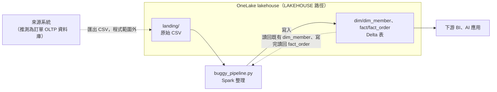
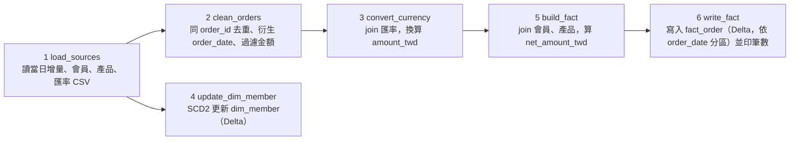

# buggy_pipeline.py 審查報告


## 目錄

- [問題總表](#問題總表)
- [1. 摘要](#1-摘要)
- [2. 背景](#2-背景)
  - [2.1 程式用途與流程](#21-程式用途與流程)
  - [2.2 審查範圍](#22-審查範圍)
- [3. 方法](#3-方法)
- [4. 發現](#4-發現)
  - [4.1 資料遺失（#1、#7、#8）](#41-資料遺失178)
  - [4.2 重複計算（#3、#4、#5）](#42-重複計算345)
  - [4.3 SCD2 實作（#2、#6）](#43-scd2-實作26)
  - [4.4 驗證與執行可靠度（#9、#10）](#44-驗證與執行可靠度910)
  - [4.5 效能與型別（#11、#12）](#45-效能與型別1112)
  - [4.6 靜態分析（linter）](#46-靜態分析linter)
- [5. 修正建議](#5-修正建議)
  - [5.1 修正優先順序](#51-修正優先順序)
  - [5.2 要求 AI（或工程師）怎麼修改](#52-要求-ai或工程師怎麼修改)
  - [5.3 若已部署到 prod：資料怎麼復原](#53-若已部署到-prod資料怎麼復原)
- [6. 結論](#6-結論)

## 問題總表

嚴重度定義見第 3 節：P0 資料錯誤或遺失；P1 特定情境出錯或讓問題無法被發現；P2 效能或可維護性。

| # | 嚴重度 | 函式 | 問題 | 小節 |
|---|---|---|---|---|
| 1 | P0 | `convert_currency` | 匯率 inner join 丟掉全部 TWD 訂單 | 4.1 |
| 2 | P0 | `update_dim_member` | SCD2 寫入把整張會員維度表覆寫成只剩變更會員 | 4.3 |
| 3 | P0 | `write_fact` | 事實表用 append，重跑或跨日更新都會重複 | 4.2 |
| 4 | P0 | `build_fact` | 事實表 join 原始會員快照而非維度表，一對多放大 | 4.2 |
| 5 | P0 | `clean_orders` | 去重保留任意一筆，不是最新狀態 | 4.2 |
| 6 | P1 | `update_dim_member` | SCD2 不完整：舊版本沒關閉、新會員沒寫入、null 變更會漏 | 4.3 |
| 7 | P1 | `clean_orders` | 靜默丟掉 0 元與負數金額的訂單 | 4.1 |
| 8 | P1 | `build_fact` | 產品 inner join 靜默丟掉對不到產品的訂單 | 4.1 |
| 9 | P1 | `write_fact`、`main` | 「驗證」沒有斷言，還把整張事實表收到 driver | 4.4 |
| 10 | P1 | `main` | 先寫 dim 再寫 fact，不是原子操作；batch_date 預設為 day1 | 4.4 |
| 11 | P2 | `convert_currency` | Python UDF 做乘法，慢，且 null 被當成 0 | 4.5 |
| 12 | P2 | `load_sources` | CSV 不指定 schema，金額比較靠隱式轉型 | 4.5 |

證據：所有筆數的查詢與輸出見 `part_b/evidence.md`；資料欄位與值域見 `notes/dataset/dictionary.md`。

## 1. 摘要

本報告審查一支由 AI Coding Agent 生成、宣稱已通過測試的 PySpark 每日訂單管線（`candidate_package/buggy_pipeline.py`）。以靜態閱讀搭配題目隨附的真實 CSV 量化影響，共找出 12 個問題，其中 5 個為 P0。最嚴重的是：匯率 inner join 會丟掉全部 TWD 訂單（day1 有 3,069 / 4,615 筆，66.5%）；SCD2 寫入會把會員維度表覆寫成只剩有變更的會員；事實表以 append 寫入，重跑會造成重複計算，若照官方語意，跨日的訂單更新也會。程式自帶的驗證只印筆數、沒有任何斷言，因此這些錯誤在執行時不會被發現。**結論：不可部署**，需依第 5 節的順序修正並重新審查。

## 2. 背景

### 2.1 程式用途與流程

每天執行一次的訂單 ETL：把當天的增量訂單 CSV 整理成事實表 `fact_order`，給下游的 BI 和 AI 應用查詢；同時維護會員維度表 `dim_member`（SCD Type 2，保留會員屬性的歷史版本）。依據是程式開頭的模組 docstring（`本管線由 AI Coding Agent 生成`）和 `main()`（`def main(batch_date: str = "day1"):`）。

這支程式在整條資料流中的位置：



依據是常數 `LAKEHOUSE = "abfss://lakehouse@onelake`：原始 CSV 和 Delta 表都放在同一個 OneLake lakehouse 底下，差別只在 `landing/` 是原檔、`dim/`、`fact/` 是 Delta 表（`format("delta")`）。程式讀 `landing/` 的 CSV（`load_sources()` 的 `f"{LAKEHOUSE}/landing/`），也讀既有的 Delta 表：`update_dim_member()` 先讀既有的 `dim_member` 再改寫（#2、#6 的成因），`write_fact()` 寫完再讀回 `fact_order`。CSV 由哪個系統匯出，程式與題目都沒有說明，上圖的來源是推測。

`main()` 依序執行 6 步：



| 步驟 | 函式 | 讀 | 寫 |
|---|---|---|---|
| 1 | `load_sources` | `landing/` 下的 4 個 CSV | — |
| 2 | `clean_orders` | 當日增量訂單 | — |
| 3 | `convert_currency` | 訂單＋`fx_rates` | — |
| 4 | `update_dim_member` | `members`＋既有的 `dim/dim_member` | `dim/dim_member` |
| 5 | `build_fact` | 步驟 3 的結果＋`members`、`products` | — |
| 6 | `write_fact` | 步驟 5 的結果 | `fact/fact_order` |

會改到既有資料的只有步驟 4 和步驟 6，第 4 節的 P0 問題大多出在這兩處，以及它們上游的 join。

### 2.2 審查範圍

審查整份 `buggy_pipeline.py`，涵蓋正確性、冪等性、資料遺失、效能與 SCD2 實作（題目要求的面向）。不涵蓋 Fabric Lakehouse 的部署設定與權限。

## 3. 方法

1. **靜態閱讀**：逐函式追資料流，對每個寫入、filter、join 檢查四件事：重跑會怎樣、哪些列會消失或變多、數字算得對不對、SCD2 是否完整。
2. **用真實資料量化影響**：題目要求不執行原管線，所以 `buggy_pipeline.py` 本身沒有執行，只用 `python3 -m py_compile` 確認語法正確。「業務影響」中的筆數，是用 Python 標準庫 `csv` 直接讀 `candidate_package/dataset/` 算出「如果這段邏輯跑下去會影響幾筆」。
3. **linter 靜態分析**：用 ruff 0.17.0（預設規則，專案沒有 ruff 設定檔）檢查 `buggy_pipeline.py`，看工具能自動抓到哪些問題，結果見 4.6。
4. **用小資料驗證關鍵語意**：撰寫期間另外在本機 `.venv`（pyspark 4.2＋delta-spark）用自建的小資料驗證三個語意：`dropDuplicates` 之後再套 window 沒有作用（#5）、`"replaceWhere", "member_id IS NOT NULL"` 搭配 overwrite 會清表（#2）、字串金額和整數比較的隱式轉型（#12）。以上查詢、腳本與輸出見 `part_b/evidence.md`；資料結構見 `notes/dataset/`。
5. **嚴重度定義**：
   - **P0**：資料錯誤或遺失，下游報表直接出錯。
   - **P1**：特定情境下出錯，或會讓問題無法被發現。
   - **P2**：效能或可維護性。

問題編號 #1～#12 依嚴重度排序，第 4 節依主題分組，總表見文首「問題總表」。

## 4. 發現

### 4.1 資料遺失（#1、#7、#8）

共同成因是「對不到就丟」：inner join 和 filter 把不符合條件的列直接拿掉，沒有隔離、沒有計數，所以丟了多少資料從輸出完全看不出來。其中 #1 用現有資料就會發生，#7、#8 是資料一出現就會發生的潛在風險。

#### #1 匯率 inner join 丟掉全部 TWD 訂單〔P0〕

**(a) 問題**：`convert_currency` 用 `orders["currency"] == fx["currency"]` 做 **inner join**，但 `fx_rates.csv` 只有 USD、JPY 兩種幣別，沒有 TWD 對 TWD 的匯率。inner join 對不到就會把那一列丟掉。另外，任何一天缺匯率的外幣訂單也會被靜默丟掉。

**(b) 業務影響**：day1 有 4,615 筆訂單，其中 TWD 3,069 筆（66.5%）全部消失，day2、day3 的比例也差不多。BI 看到的營收大約只有實際的三分之一，而且沒有任何錯誤訊息。

**(c) 修正**：TWD 直接用匯率 1，外幣改成 left join，對不到匯率的訂單送進隔離表並告警，不要丟掉。

```python
joined = orders.join(fx, on=[orders.currency == fx.currency,
                             orders.order_date == fx.rate_date], how="left")
rate = F.when(orders.currency == "TWD", F.lit(1.0)).otherwise(fx.rate_to_twd)
converted = joined.withColumn("amount_twd", F.col("amount").cast("decimal(18,2)") * rate)
missing_fx = converted.filter(F.col("amount_twd").isNull())  # 寫入隔離表並告警
```

#### #7 `filter(F.col("amount") > 0)` 靜默丟掉 0 元和負數訂單〔P1〕

**(a) 問題**：`clean_orders` 用 `filter(F.col("amount") > 0)` 過濾金額。0 元和負數金額可能是合法的業務資料（全額折抵、退款、更正），程式直接丟掉，也沒有記錄。另外 `amount` 是字串，這個比較實際上是隱式轉型成整數：ANSI 關閉時 0 到 1 之間的金額也會被丟掉，ANSI 開啟時管線直接報錯，見 #12 (b)。

**(b) 業務影響**：目前三個增量檔裡沒有這種資料，但 `orders_base` 有 50 筆 `amount <= 0`，代表這種資料真的會出現。一旦出現，退款不會沖銷營收，營收就被高估，而且沒有人會知道。

**(c) 修正**：先跟業務確認負數的意義。不合格的資料送隔離表並計數告警，不要靜默 filter。

#### #8 產品 inner join 靜默丟單〔P1〕

**(a) 問題**：`build_fact` 中的 `with_member.join(products, "product_id", "inner")`，產品主檔沒有的訂單會消失。

**(b) 業務影響**：目前三個增量檔的 product_id 都對得到，但商品下架或主檔延遲更新時，訂單就會消失。營收短少，而且沒有告警。

**(c) 修正**：改 left join，`product_id` 對不到的列計數並告警；或者在維度表放一筆「未知產品」的預設列。

### 4.2 重複計算（#3、#4、#5）

共同成因是沒有守住「一張訂單在事實表只有一列」：寫入用 append 而不是以 `order_id` upsert（#3）、join 到一對多的快照表（#4）、去重沒有依時間取最新（#5）。三者都會讓金額被重複加總，而且重跑會讓情況更糟。

#### #3 事實表用 append：重跑會重複，跨日訂單更新也會重複〔P0〕

**(a) 問題**：`write_fact` 用 `mode("append")`，沒有用 `order_id` 做 upsert，所以：
- **重跑**：同一個 batch 跑兩次，這批資料就寫進去兩份，不符合冪等性。
- **訂單更新**：官方 README 定義同一 order_id 以 `updated_at` 區分新舊；若照此語意，增量檔裡和 base 同 order_id 的列是既有訂單的新版本（例如 paid → completed）。append 會讓新的那一列和原本那列並存；新列的 `order_date` 由它自己的 `order_created_at` 衍生，而這些列的 `order_created_at` 和 base 不同（見 (b)），所以不一定落在原本那一列的分區。

**(b) 業務影響**：
- 重跑一次，該批次的訂單金額翻倍（分散在多個 `order_date` 分區：day1 的 `order_created_at` 從 2026-05-01 到 07-01，橫跨 62 個 `order_date`）。
- 實測 day1 增量有 597 個 order_id（603 列）已經存在於 `orders_base`。若照官方語意，在 append 的寫法下：
  - **金額**：這 603 列**全部**會和 base 的原列並存，金額重複計算。day2、day3 各約 600 筆同樣情況，另外還有跨增量檔的重複（day2 有 25 筆在 day1 出現過）。
  - **狀態**：其中 485 列的狀態和 base 不同（例如同一張單同時有 paid 和 completed 兩列），這只額外影響狀態統計。
- **與官方語意不符的現象，需向上游確認**：這 603 列的 `order_created_at`、`member_id`、`amount` 沒有一列跟 base 相同（逐欄比對，三欄各自相同的列數都是 0）。例如 `ORD00005192` 在 base 是 2026-05-06、M007765、10230.87，在 day1 是 2026-05-04、M005173、6927。同一張訂單的更新不應該改變下單時間與會員，所以這些列也可能是另一張訂單使用了相同的 order_id。#5 的 3 組也有同樣的現象。order_id 是否可作為唯一鍵，留待 Part A 以 ADR 定案。不論哪種解讀，重跑造成的重複都成立。

**(c) 修正**（以官方語意為前提）：以 `order_id` 為 key 做 Delta `MERGE`：`whenMatchedUpdateAll`（只在來源的 `updated_at` 比較新時更新）＋`whenNotMatchedInsertAll`。另一個做法是對受影響的 `order_date` 分區用 `replaceWhere` 整區重算，但訂單會跨分區更新，MERGE 比較單純。

```python
from delta.tables import DeltaTable
tgt = DeltaTable.forPath(spark, f"{LAKEHOUSE}/fact/fact_order")
(tgt.alias("t").merge(fact.alias("s"), "t.order_id = s.order_id")
    .whenMatchedUpdateAll(condition="s.updated_at > t.updated_at")
    .whenNotMatchedInsertAll()
    .execute())
```
（需要在 fact 加上 `updated_at` 欄位。Delta MERGE 的來源若同一個 `order_id` 有多列會直接報錯，所以要先修好 #4 的一對多 join（會讓同一個 `order_id` 變成多列）和 #5 的去重（每個 `order_id` 要剛好留下最新的一列）。）

#### #4 事實表 join 的是原始 members 快照，不是維度表〔P0〕

**(a) 問題**：`main()` 中的 `dim_member = update_dim_member(members)` 把回傳值存起來之後就沒用到；`fact = build_fact(converted, members, products)` 傳進去的是原始的 `members.csv`，`build_fact` 再用 `converted.join(members, "member_id", "left")` 關聯。這份檔裡同一個會員有多個 `extract_date` 快照，join 後就變成一對多。

**(b) 業務影響**：實測 `members.csv` 有 8,991 列，但只有 8,000 個會員，其中 989 人有 2 到 3 筆快照。以 day1 原始增量的全部 4,615 列計算（尚未去重、TWD 也未被丟），有 570 列屬於這些會員，join 後多出 571 列，金額跟著重複計算。這個數字的前提是 join 前的列數不受其他問題影響：若 #1、#5 已修好（TWD 保留、每個 order_id 留一列，共 4,597 列），多出 569 列；照現在管線的順序，`dropDuplicates` 之後又被匯率 inner join 丟掉 TWD，只剩 1,536～1,538 列進入這個 join，多出 182～183 列（範圍來自 `dropDuplicates` 留下哪一列不確定）。一對多 join 會讓同一張訂單的每個快照各產生一列，同時帶著不同快照的 `member_level`（等級變過的會員，新舊等級各一列），而不是訂單成立當時的等級。

**(c) 修正**：改 join 修好之後的 dim_member，條件用半開區間 `valid_from <= order_date < valid_to`（point-in-time join；#6 的寫法讓舊版的 `valid_to` 和新版的 `valid_from` 是同一天，半開區間才不會讓這一天的訂單同時對到新舊兩版）。前提是 dim 已照 #6 (c)「初始載入」回填歷史版本，否則早於會員第一版 `valid_from` 的訂單會對不到任何版本（照初始載入回填，就不會對不到，但不含被 #6 隔離的 28 位同分會員：day1 有 17 張對不到，要靠 #6 的隔離告警處理）。更好的做法是 fact 只存 `member_sk`，等級從維度表查。

#### #5 去重保留的是任意一筆，不是最新狀態〔P0〕

**(a) 問題**：`clean_orders` 先 `dropDuplicates(["order_id"])`，每個 order_id 已經只剩一列，而且是任意一列；後面的 `F.row_number().over(w)` 永遠只對到一列，等於沒作用。window 的排序鍵也選錯了：`orderBy(F.col("order_created_at").desc())` 依下單時間排序。官方 README 定義同一 order_id 以 `updated_at` 區分新舊；若照此語意，同一張訂單的多次更新 `order_created_at` 相同、`updated_at` 不同，應該按 `updated_at` 排序。

**(b) 業務影響**：實測 day1 有 18 個 order_id 重複，18 組的 `updated_at` 都不同。保留哪一筆是不確定的，同樣的輸入重跑可能得到不同結果。其中 15 組除了 `updated_at` 之外每個欄位都相同，狀態也相同，符合官方語意。例如 `ORD00005192` 兩列都是 completed，`updated_at` 只差 26 秒（22:37:32 與 22:37:58），`dropDuplicates` 留下哪一列不確定，而事實表的 `updated_at` 又是 #3 MERGE 判斷新舊的依據。另外 3 組（`ORD00036457`、`ORD00047034`、`ORD00076774`）連 `order_created_at`、`member_id`、`amount` 都不同，這是**與官方語意不符的現象，需向上游確認**；同樣的現象也出現在 #3 的全部 603 列（增量列和 base 的這三欄全都不同）。例如 `ORD00036457` 一列是 M002150 的 completed 訂單（TWD 200,659），另一列是 M000272 的 cancelled 訂單（USD 18,042.46）。若照官方語意，取 `updated_at` 最新的一列即可；若實際是兩張不同的訂單，任何去重都會讓其中一張消失。order_id 是否可作為唯一鍵，留待 Part A 以 ADR 定案。

**(c) 修正**：拿掉 `dropDuplicates`，只用 window，按 `updated_at` 由新到舊排序（官方語意）。在上游確認前，主要欄位不一致的重複列先送隔離表。

```python
w = Window.partitionBy("order_id").orderBy(F.col("updated_at").desc())
latest = orders_inc.withColumn("rn", F.row_number().over(w)).filter("rn = 1").drop("rn")
```

### 4.3 SCD2 實作（#2、#6）

`update_dim_member` 自稱 SCD Type 2（Slowly Changing Dimension：屬性改變時保留舊版本並標註有效期間），但寫入方式（#2）和變更偵測邏輯（#6）都不符合 SCD2：沒有版本欄位、舊版不會被關閉，寫入時還把整張表覆寫掉。兩點要一起修。

#### #2 SCD2 寫入把整張 dim_member 覆寫成只剩變更會員〔P0〕

**(a) 問題**：`update_dim_member` 中的 `updated.write.format("delta").mode("overwrite")` 搭配 `"replaceWhere", "member_id IS NOT NULL"`，條件涵蓋所有列，等於整張表 overwrite。寫進去的只有 `updated`，也就是「有變更的會員」。

**(b) 業務影響**：每次執行都會把整張 dim_member 換成「當天有變更的會員」。假設 dim 初始已有全部會員（8,000 人），第一次執行後只剩這次有變更的會員，其餘會員連同歷史版本全部消失。同一份 members 第二次跑時，dim 裡的屬性大多已經和最新快照相同，`changed` 幾乎為空，dim 會被幾乎清空；沒有任何會員變更的那天也一樣。說「幾乎」是因為有 28 位會員在最新的 `extract_date` 有兩筆快照（同分，見 #6 (b)），`row_number` 每次跑都可能挑到不同的那一列，這些會員可能再次被判定為「有變更」而留下來。需要的歷史版本是被刪掉，不是被保留。Delta 雖然可以 time travel 救回，但前提是要有人發現，而且要在保留期內、還沒被 VACUUM 清掉舊檔之前（見 5.3）。

**(c) 修正**：改用 Delta `MERGE`，見 #6 的完整寫法。

#### #6 SCD2 邏輯不完整〔P1，與 #2 合併修〕

**(a) 問題**：
- **沒有關閉舊版本**：沒有 `valid_to`、`is_current`，舊版本也不會被標成失效，所以不算 SCD2。
- **新會員不會被寫入**：`dim.alias("d").join(latest_snap.alias("s"), "member_id")` 是 inner join，dim 裡還沒有的會員永遠進不來。
- **null 比較會漏掉變更**：`F.col("d.member_level") != F.col("s.member_level")` 這類 `!=` 比較遇到 null 會得到 null，被 filter 當成 false，city 從 null 變成有值的變更會被漏掉。dataset 的 city 沒有空值，缺值是用字串 `N/A` 表示（71 筆），所以這是程式碼層面的風險；而 `N/A` 是一般字串，city 從 `N/A` 變成有值（或反過來）也會被當成「變更」。
- **dim 有多版本時會重複比對**：沒有限定只跟 dim 的「目前版本」比較，會跟每一個歷史版本各比一次。
- **同一天的快照同分時任意挑一列**：`update_dim_member` 的 `Window.partitionBy("member_id").orderBy(F.col("extract_date").desc())` 只依 `extract_date` 排序，同一個會員在同一個 `extract_date` 有兩列時，留下哪一列是任意的。

**(b) 業務影響**：會員升等的歷史查不到，「升等前後的消費變化」這類分析做不出來；新註冊會員在維度表裡找不到。實測 989 位多快照會員中，434 人的 `member_level` 有變過、376 人的 `city` 有變過。另外 `members` 的 (member_id, extract_date) 有 30 組重複（每組 2 列），其中 28 組落在該會員最新的 `extract_date`，這 28 組兩列的 `member_level` 都不同（city 相同），例如 M000096 在 2026-04-30 同時有金卡和銀卡。這 28 位會員的目前等級取決於 `row_number` 任意挑到哪一列，同樣的輸入重跑可能寫進不同的等級。

**(c) 修正**：標準的 Delta MERGE 兩段式寫法：先把有變更的目前版本關閉（設定 `valid_to`、`is_current=false`），再插入新版本與新會員。比較時用 null-safe 的 `<=>`（`eqNullSafe`）。取最新快照前先處理同分：同一會員在最新 `extract_date` 有多列時送隔離表並告警，本批不更新該會員；另一個做法是加上次排序鍵讓結果固定，但 `members` 沒有能判斷同日先後的欄位，次排序鍵只能讓結果可重現，不能保證選對，需要跟上游確認。

```python
w_m = Window.partitionBy("member_id")
top = (members.withColumn("max_dt", F.max("extract_date").over(w_m))
       .filter(F.col("extract_date") == F.col("max_dt"))
       .withColumn("n", F.count("*").over(w_m)))
ambiguous = top.filter("n > 1")   # 最新快照同分：寫入隔離表並告警
latest_snap = top.filter("n = 1").drop("max_dt", "n")

cur = dim.filter("is_current")
chg = (latest_snap.alias("s").join(cur.alias("d"), "member_id", "left")
       .filter(F.col("d.member_id").isNull()
               | ~F.col("s.member_level").eqNullSafe(F.col("d.member_level"))
               | ~F.col("s.city").eqNullSafe(F.col("d.city"))))
# 1) MERGE：對 chg 中已存在的會員，把目前版本的 valid_to 設為 s.extract_date、is_current 設為 false
# 2) INSERT：chg 全部插入新版本，valid_from=extract_date、valid_to='9999-12-31'、is_current=true
# 有效期間為半開區間 [valid_from, valid_to)：舊版 valid_to 與新版 valid_from 同一天也不重疊（#4 的 join 條件同此）
```

**初始載入**：上面的寫法每次只拿每位會員最新的 `extract_date` 去 MERGE，適用於 dim 已有歷史之後的每日增量。dim 從空表開始時，若直接拿現在的 `members` 跑，每位會員只會建出最新的一版，2026-04-30、05-31 的舊快照永遠進不了 dim，(b) 的 434 位等級變過的會員，舊等級就丟了，等於退化成 SCD1。搭配 #4 的半開區間 join，`order_date` 早於該會員唯一一版 `valid_from` 的訂單對不到任何版本，`member_level` 變成 null：實測 day1 去重後（每個 order_id 留 `updated_at` 最新一列）4,597 張中有 49 張（48 位會員，`order_date` 落在 05-01～06-28），因為這些會員的最新 `extract_date` 是 05-31（16 張）或 06-30（33 張）。做法二選一，之後再接每日增量（只處理比 dim 已載入的最新 `extract_date` 更新的快照）：
- **依 `extract_date` 由舊到新逐批 MERGE**（04-30 → 05-31 → 06-30）：沿用同一段邏輯，屬性沒變的批次自然不產生新版本，最單純。
- **一次性回填全部快照**：用 window 依 `extract_date` 排序，以下一筆快照的 `extract_date` 當這一版的 `valid_to`；但要自己合併相鄰且屬性相同的快照（否則沒變也多一版），同日同分也要先處理。

新會員第一版的 `valid_from` 有三個選擇，選哪個屬於業務定義，需要確認：
- **第一筆快照的 `extract_date`**：只記錄實際觀測到的狀態；代價是早於第一筆快照的訂單對不到任何版本。目前資料除同分會員外沒有這種訂單（逐批 MERGE 後，不含被隔離的 28 位同分會員：day1 去重後有 17 張對不到，要靠 #6 的隔離告警處理，其餘 0 張；`orders_base` 日期為 ISO 格式的 97,039 列也是 0 列早於該會員最早的 `extract_date`）。
- **`register_date`**：會員從註冊起就有一版；代價是把第一筆快照的等級往前套到註冊日，這是推定，不是觀測。目前資料沒有會員的 `register_date` 晚於最早的 `extract_date`，day1、base 也沒有訂單早於 `register_date`。
- **很早的固定日期（例如 1900-01-01）**：保證每張訂單都對得到一版；代價同樣是推定，而且看不出哪些區間是推定的。

### 4.4 驗證與執行可靠度（#9、#10）

共同成因是管線假設自己一定成功：驗證只印筆數不做斷言（#9），寫入順序與預設參數也沒考慮失敗和誤操作（#10）。這讓 4.1 到 4.3 的問題都無法在執行時被發現，也是「宣稱已通過測試」卻仍有大量錯誤的原因。

#### #9 「驗證」沒有任何斷言，還把整張事實表 collect 到 driver〔P1〕

**(a) 問題**：
- `write_fact` 用 `load(f"{LAKEHOUSE}/fact/fact_order").collect()` 把整張事實表收回 driver，再用 Python 迴圈計數。
- 計數完只有 `print`，沒有和預期值比較。
- `main()` 最後無條件印出 `資料品質已確保`。

**(b) 業務影響**：
- 效能：事實表一天一天累積，collect 遲早讓 driver OOM，管線會掛掉。
- 可觀測性：前面 #1 到 #5的丟單和重複，這段「驗證」一個都抓不到，反而讓人以為沒問題。題目說的「已通過測試」很可能就是這個狀況。

**(c) 修正**：用 Spark 端聚合（`groupBy("order_date").count()`），只驗證本批次影響的分區；加上真正的斷言：輸入筆數 = 寫入筆數 + 隔離筆數、`order_id` 唯一、`amount_twd` 非 null。不通過就 `raise`。

#### #10 執行順序與失敗處理〔P1〕

**(a) 問題**：
- dim 先寫、fact 後寫，兩者不是同一個 transaction，fact 失敗時 dim 已經被改掉了。
- `def main(batch_date: str = "day1"):` 有預設值，忘了帶參數就會重跑 day1，再加上 #3 的 append，資料就重複了。
- 沒有初始化步驟：第一次執行時 dim_member 不存在，`update_dim_member` 開頭的 `dim = spark.read.format("delta").load(f"{LAKEHOUSE}/dim/dim_member")` 就會直接失敗。

**(b) 業務影響**：部分失敗之後，dim 和 fact 的狀態不一致；排程設定錯誤時，day1 的資料會重複寫入。

**(c) 修正**：`batch_date` 改成必填，而且要驗證格式。每一步都做成冪等（MERGE），失敗後直接整批重跑就好；或者記錄批次狀態表，已完成的批次就跳過。dim_member 不存在時先建立空表，再照 #6 (c)「初始載入」回填歷史，之後才走每日 MERGE。

### 4.5 效能與型別（#11、#12）

這兩點不會立刻讓數字算錯，但會讓管線變慢，或讓上游格式變動時的錯誤被靜默吞掉。

#### #11 Python UDF 做乘法〔P2〕

**(a) 問題**：`convert_currency` 中的 `to_twd_udf = F.udf(to_twd, DoubleType())`，一個簡單的乘法用 Python UDF 寫，每一列都要在 JVM 和 Python 之間序列化；而且 `amount is None` 回傳 0.0，把缺值當成 0 元。

**(b) 業務影響**：大量資料時明顯變慢；缺值的金額被當成 0 加總，看起來不會出錯。

**(c) 修正**：用內建欄位運算 `F.col("amount") * F.col("rate_to_twd")`，null 自然傳遞，之後交給品質檢查處理。

#### #12 CSV 不指定 schema〔P2〕

**(a) 問題**：`load_sources` 的 4 次讀檔都是 `spark.read.option("header", True).csv(`，沒給 schema，也沒設 `inferSchema`，所以所有欄位都是字串。金額比較和相減全靠隱式轉型，`order_date` 也是字串。

**(b) 業務影響**：以 `clean_orders` 的 `filter(F.col("amount") > 0)` 為例，`amount` 是字串、`0` 是整數，Spark 會把字串轉成整數再比較，結果取決於 `spark.sql.ansi.enabled`（本機 pyspark 4.2 小資料實跑 `explain()`）：
- **ANSI 關閉**（Spark 3.x 的預設，Fabric 的 Spark 3.x runtime 屬於這類）：實際條件是 `cast(amount as int) > 0`。`0.5` 被截成 0 而被濾掉；格式不對的值（例如千分位 `1,200`）轉成 null，也被靜默濾掉，不會報錯。
- **ANSI 開啟**（Spark 4 的預設，本機 4.2 確認預設為 true）：實際條件是 `cast(amount as bigint) > 0`，帶小數點的字串無法轉成 bigint，報 `CAST_INVALID_INPUT` 錯誤，管線直接掛掉。不只 `0.5`，`100.0` 這種整數值也一樣；三個增量檔的金額全部帶小數點（例如 `13100.0`；不含小數點的列數 day1、day2、day3 都是 0），用 day1 實際檔案跑同一個 filter 就會報錯。
- 目前資料的影響：三個增量檔的金額最小值是 83.24（day3），沒有 0 到 1 之間或格式不對的值，所以在 ANSI 關閉時不影響現在的數字（day1 4,615 列 filter 後仍是 4,615 列）；ANSI 開啟時則是整條管線失敗。

**(c) 修正**：明確定義 `StructType` schema，並設定 `mode("FAILFAST")`，或者把壞掉的列導到隔離區。

### 4.6 靜態分析（linter）

這一節回答：程式自稱「已通過語法檢查」，那 linter 能抓到第 4.1～4.5 節的多少問題？

**指令與輸出**（在 repo 根目錄執行，ruff 0.17.0，預設規則）：

```
$ uv run ruff check --output-format concise LionDEExam/candidate_package/buggy_pipeline.py
LionDEExam/candidate_package/buggy_pipeline.py:1:1: UP009 [*] UTF-8 encoding declaration is unnecessary
LionDEExam/candidate_package/buggy_pipeline.py:14:1: I001 [*] Import block is un-sorted or un-formatted
LionDEExam/candidate_package/buggy_pipeline.py:172:5: F841 Local variable `dim_member` is assigned to but never used
Found 3 errors.
[*] 2 fixable with `--fix` (1 unsafe fix available with `--fix --unsafe-fixes`).
```

| 規則 | 位置（函式／片段） | 意義 | 影響 |
|---|---|---|---|
| UP009 | 檔案開頭 `# -*- coding: utf-8 -*-` | Python 3 預設就是 UTF-8，編碼宣告多餘 | 只是風格，不影響正確性 |
| I001 | 檔案開頭的 import 區塊 `from pyspark.sql import SparkSession, functions as F, Window` | import 沒有排序 | 只是風格，不影響正確性 |
| F841 | `main()`：`dim_member = update_dim_member(members)` | 變數被指派但從未使用 | 正好是 #4 的跡象 |

**F841 對應 #4**：維度表算出來了（`dim_member`），事實表卻沒用它，`build_fact(converted, members, products)` 傳進去的是原始的 members 快照。linter 抓得到「變數沒用到」這個症狀，抓不到背後的業務錯誤：它不知道 `members` 有多個快照、join 會一對多放大金額，也不知道事實表該用 point-in-time join 取當時的等級。

**結論**：linter 只抓到 12 個問題中 1 個的跡象（#4），其餘 11 個（丟單、重複寫入、SCD2 覆寫、隱式轉型等）都是語意層面的錯，語法完全合法。所以 AI 宣稱的「通過語法檢查」不能代表程式正確。

## 5. 修正建議

### 5.1 修正優先順序

1. 先修 P0（#1～#5）：這幾點在現有資料上就會讓營收和會員資料出錯。#2 與 #6 一起修。#3 需要 #4 和 #5 先修好：Delta MERGE 的來源若同一個 `order_id` 有多列會直接報錯，#4 的一對多 join 會讓同一個 `order_id` 變成多列，#5 的去重要確保每個 `order_id` 剛好留下最新的一列。
2. 再修 #9、#10，讓之後的錯誤能在執行時被發現、失敗後能安全重跑。
3. 接著修 #7、#8 的靜默丟單，最後處理 P2。

### 5.2 要求 AI（或工程師）怎麼修改

1. **先補會失敗的測試，再改程式**：用以下情境當測試案例：TWD 訂單、同一天重跑兩次、跨日狀態更新、會員多快照、新會員、0 元訂單。每一條都要能重現第 4 節的問題。
2. **所有寫入改成以業務 key 做 MERGE**（fact 用 `order_id`，dim 用 `member_id` 加版本），重跑結果必須相同。
3. **不再靜默丟資料**：每一個 filter 和 join 都要能說明丟掉的列去了哪裡（隔離表）、丟了多少（計數）。
4. **驗證要有斷言**，筆數對帳不平就讓管線失敗，不要只印成功訊息。
5. **CI 要跑 ruff**，並且把 F841 這類「算了沒用」的警告當成錯誤處理（不通過就擋下合併），風格類規則（UP009、I001）可以用 `--fix` 自動修。
6. **修正後重新審查**：確認以上的修改，不接受「已通過測試」的自我宣稱。

### 5.3 若已部署到 prod：資料怎麼復原

**前提**：這支程式的 PR 已合併，在 prod 跑過幾個批次，ANSI 關閉（Fabric 的 Spark 3.x runtime，見 #12）。若 ANSI 開啟，每一批都會在 `write_fact` 報錯，但 `update_dim_member` 已先寫入，結果是 fact 乾淨、只有 dim 被 #2 覆寫，只需修 dim。

**結論：現有的表不能就地修補。要從乾淨的起點、用修正後的程式重新寫入新表，對帳後再切換。** 乾淨的起點有兩種：

| 起點 | 做法 | 前提 |
|---|---|---|
| A. 退回 bug 之前的版本 | 用 `versionAsOf` 讀出乾淨版本、寫成獨立的新表，再重播增量 | 重播用的 landing 增量檔還在；有乾淨版本（fact 若是這支程式第一次 append 時才建立，版本 0 就已有錯；dim 這支程式建不出來，一定是別人建的）；舊資料檔與交易紀錄都還在保留期內；新程式需要的欄位（fact 的 `updated_at`、dim 的 `valid_to`、`is_current`）要先補上並回填，否則「`updated_at` 比較新才更新」的條件比不出結果，更新會被靜默略過（類似 E10 [6]；[6] 測的是時間相同，欄位為 null 的情況依 SQL 語意推論，未實測） |
| B. 從原始檔重建 | dim 用 `members.csv` 的歷次快照依 `extract_date` 回填（#6 (c)「初始載入」），fact 從 `orders_base` 起依序重播 | landing 的原始檔都還在 |

A 的好處是保留 bug 上線前 fact 已有的歷史：這支程式從沒讀過 `orders_base`，那些歷史從哪裡來沒有交代，B 只能從 `orders_base` 近似。#1、#7、#8 丟掉的訂單兩條路都一樣，只能靠重播增量補回；RESTORE 或 CLONE 只會退掉錯的資料，不會補回沒寫的資料。28 位同分會員不論哪條路，都要上游確認後才能補齊（#6）。

**步驟**：
1. 停止排程，暫停 VACUUM，並調高保留期，保住舊版本。
2. 用 `DESCRIBE HISTORY` 找出 bug 跑了哪些批次、最後一個乾淨版本。
3. 先建 dim，驗證後再建 fact：修正後的 fact 要用 point-in-time join 對 dim 的有效區間（#4 (c)），dim 沒先好，訂單會對不到版本。
4. 對帳：新表的筆數、金額要和原始檔對得上（輸入 = 輸出 + 隔離，#9），通過後才取代正式表。
5. 通知下游哪些日期的數字有誤，重新發佈。

**回不去的部分（單向門）**：
- **超過保留期**：VACUUM 會刪掉超過保留期的舊資料檔（Delta 規格預設 7 天，[PROTOCOL](https://github.com/delta-io/delta/blob/master/PROTOCOL.md)），之後交易紀錄還列得出舊版本，但 time travel 與 RESTORE 都會失敗（E10 [3]）。交易紀錄本身也會在寫 checkpoint 時自動清掉超過保留期的部分（預設 30 天，[Delta 文件](https://docs.delta.io/latest/delta-batch.html)），所以就算沒跑 VACUUM，也不是永遠退得回去。開源 Delta 不會自動 VACUUM；Fabric 是否排程了表格維護，要查 workspace 設定（未查證）。超過保留期就只剩 B。
- **landing 原始檔被刪除或覆寫**：丟掉的訂單補不回來。`members.csv`、`products.csv`、`fx_rates.csv` 的檔名沒有日期，若 prod 每天覆寫，重播只能用現在的主檔近似當時的狀態。
- **下游已經用掉的數字**：表修好也收不回。

所以修正後的版本除了 5.2 的修改，還要做到：landing 原始檔不可修改、不可刪除（主檔按日保存）；保留期長於「發現錯誤所需的時間」；寫入後的斷言（#9）不通過就停止排程並告警，不讓錯誤流到下游。

## 6. 結論

**不可部署。** 這支管線第一次跑就會丟掉約三分之二的訂單（所有 TWD 訂單），把會員維度表清到只剩有變更的會員，事實表每天累積重複資料；重跑同一個批次，該批次的資料會再多一份。程式自帶的「驗證」只印出筆數，什麼都沒有檢查，所以測試過了也抓不到這些問題。order_id 的語意（#3、#5）雖然待上游確認，但不影響這個結論：不論哪種解讀，#1、#2、#4 都成立。須依第 5 節修正、補上能重現問題的測試，並重新審查後才能部署。
