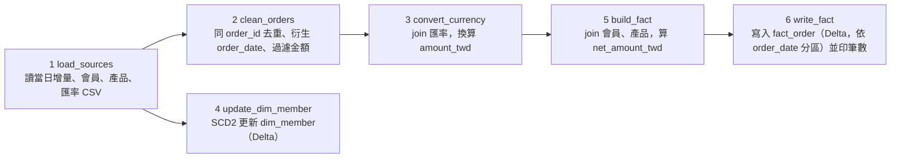
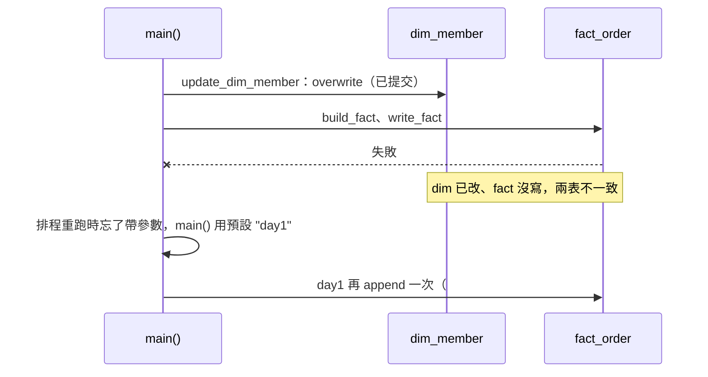

# buggy_pipeline.py 審查報告

## 目錄

- [問題總表](#問題總表)
- [1. 摘要](#1-摘要)
- [2. 背景](#2-背景)
  - [2.1 程式用途與流程](#21-程式用途與流程)
  - [2.2 審查範圍](#22-審查範圍)
- [3. 方法](#3-方法)
- [4. 發現](#4-發現)
  - [4.1 步驟 1 讀取來源檔](#41-步驟-1-讀取來源檔)
  - [4.2 步驟 2 清理訂單](#42-步驟-2-清理訂單)
  - [4.3 步驟 3 換算台幣](#43-步驟-3-換算台幣)
  - [4.4 步驟 4 更新會員維度表](#44-步驟-4-更新會員維度表)
  - [4.5 步驟 5 組出事實表](#45-步驟-5-組出事實表)
  - [4.6 步驟 6 寫入與驗證事實表](#46-步驟-6-寫入與驗證事實表)
  - [4.7 main 執行流程](#47-main-執行流程)
- [5. 修正建議](#5-修正建議)
  - [5.1 修正優先順序](#51-修正優先順序)
  - [5.2 要求 AI（或工程師）怎麼修改](#52-要求-ai或工程師怎麼修改)
  - [5.3 若已部署到 prod：資料怎麼復原](#53-若已部署到-prod資料怎麼復原)
- [6. 結論](#6-結論)

## 問題總表

問題編號依程式執行順序（`main()` 的 6 個步驟）排列，與第 4 節的小節順序一致。

**嚴重度定義**：
- **P0**：資料錯誤或遺失，下游報表直接出錯。
- **P1**：特定情境下出錯，或會讓問題無法被發現。
- **P2**：效能或可維護性。

| # | 嚴重度 | 函式 | 問題 | 小節 |
|---|---|---|---|---|
| 1 | P2 | `load_sources` | CSV 不指定 schema，金額比較靠隱式轉型 | 4.1 |
| 2 | P0 | `clean_orders` | 去重保留任意一筆，不是最新狀態 | 4.2 |
| 3 | P1 | `clean_orders` | 靜默丟掉 0 元與負數金額的訂單 | 4.2 |
| 4 | P0 | `convert_currency` | 匯率 inner join 丟掉全部 TWD 訂單 | 4.3 |
| 5 | P2 | `convert_currency` | Python UDF 做乘法，慢，且 null 被當成 0 | 4.3 |
| 6 | P0 | `update_dim_member` | SCD2 實作錯誤：覆寫整張表、沒關舊版、新會員進不來 | 4.4 |
| 7 | P0 | `build_fact` | 事實表 join 原始會員快照而非維度表，一對多放大 | 4.5 |
| 8 | P1 | `build_fact` | 產品 inner join 靜默丟掉對不到產品的訂單 | 4.5 |
| 9 | P0 | `write_fact` | 事實表用 append，重跑或跨日更新都會重複 | 4.6 |
| 10 | P1 | `write_fact`、`main` | 「驗證」沒有斷言，還把整張事實表收到 driver | 4.6 |
| 11 | P1 | `main` | 先寫 dim 再寫 fact，不是原子操作；batch_date 預設為 day1 | 4.7 |

證據：所有筆數的查詢與輸出見 `part_b/evidence.md`；資料欄位與值域見 `notes/dataset/dictionary.md`。

## 1. 摘要

本報告審查一支由 AI Coding Agent 生成、宣稱已通過測試的 PySpark 每日訂單管線（`candidate_package/buggy_pipeline.py`）。以靜態閱讀搭配題目隨附的真實 CSV 量化影響，共找出 11 個問題，其中 5 個為 P0（#2、#4、#6、#7、#9）。最嚴重的是：匯率 inner join 會丟掉全部 TWD 訂單（#4，day1 有 3,069 / 4,615 筆，66.5%）；SCD2 寫入會把會員維度表覆寫成只剩有變更的會員（#6）；事實表以 append 寫入，重跑會造成重複計算，若照官方語意，跨日的訂單更新也會（#9）。程式自帶的驗證只印筆數、沒有任何斷言，因此這些錯誤在執行時不會被發現。**結論：不可部署**，需依第 5 節的順序修正並重新審查。

## 2. 背景

### 2.1 程式用途與流程

每天執行一次的訂單 ETL：把當天的增量訂單 CSV 整理成事實表 `fact_order`，給下游的 BI 和 AI 應用查詢；同時維護會員維度表 `dim_member`（SCD Type 2，保留會員屬性的歷史版本）。依據是程式開頭的模組 docstring（`本管線由 AI Coding Agent 生成`）和 `main()`（`def main(batch_date: str = "day1"):`）。程式讀寫的位置（OneLake landing／Delta 表）見 `notes/part_b/pipeline-context.md`。

`main()` 依序執行 6 步：



會改到既有資料的只有步驟 4 和步驟 6。5 個 P0 中，#6、#9 就出在這兩步；其餘三個（#2 去重、#4 匯率 join、#7 會員 join）出在它們上游，決定寫進去的資料對不對。

### 2.2 審查範圍

審查整份 `buggy_pipeline.py`，涵蓋正確性、冪等性、資料遺失、效能與 SCD2 實作（題目要求的面向）。不涵蓋 Fabric Lakehouse 的部署設定與權限。

## 3. 方法

以靜態閱讀逐函式追資料流，再用題目隨附的真實 CSV 量化影響（不執行原管線）；關鍵的 Spark／Delta 語意另用本機小資料驗證。靜態分析方面，ruff 只抓到 11 個問題中 1 個的跡象（#7 的 F841），mypy 一個都沒抓到。步驟細節與 ruff、mypy 輸出見[附錄](appendix.md)，查詢與輸出見 [evidence.md](evidence.md)。

## 4. 發現

本節照 `main()` 的執行順序，一個步驟一小節；每個問題分 (a) 問題、(b) 業務影響、(c) 修正。跨步驟來看，問題有四種共同成因：

- **對不到就丟**（#3、#4、#8）：inner join 和 filter 把不符合條件的列直接拿掉，沒有隔離、沒有計數，所以丟了多少資料從輸出完全看不出來。其中 #4 用現有資料就會發生，#3、#8 是資料一出現就會發生的潛在風險。
- **沒有守住「一張訂單在事實表只有一列」**（#2、#7、#9）：去重沒有依時間取最新（#2）、join 到一對多的快照表（#7）、寫入用 append 而不是以 `order_id` upsert（#9）。三者都會讓金額被重複加總，而且重跑會讓情況更糟。
- **SCD2 名不符實**（#6）：`update_dim_member` 自稱 SCD Type 2（Slowly Changing Dimension：屬性改變時保留舊版本並標註有效期間），但沒有版本欄位、舊版不會被關閉，寫入時還把整張表覆寫掉。
- **假設自己一定成功**（#10、#11）：驗證只印筆數不做斷言（#10），寫入順序與預設參數也沒考慮失敗和誤操作（#11）。這讓其他問題都無法在執行時被發現，也是「宣稱已通過測試」卻仍有大量錯誤的原因。

另外兩個 P2（#1、#5）不會立刻讓數字算錯，但會讓管線變慢，或讓上游格式變動時的錯誤被靜默吞掉。

### 4.1 步驟 1 讀取來源檔

#### #1 CSV 不指定 schema〔P2〕

**(a) 問題**：`load_sources` 的 4 次讀檔都是 `spark.read.option("header", True).csv(`，沒給 schema，所有欄位都讀成字串。後面 `filter(F.col("amount") > 0)` 只能靠隱式轉型，結果取決於 `spark.sql.ansi.enabled`。

```text
amount 字串（示意）   ANSI 關：cast 成 int 再比 > 0     ANSI 開：cast 成 bigint 再比 > 0
"100"               100   → 保留                     100 → 保留
"13100.0"           13100 → 保留                     CAST_INVALID_INPUT，管線失敗
"0.5"               0     → 靜默丟掉                  CAST_INVALID_INPUT，管線失敗
"1,200"             null  → 靜默丟掉                  CAST_INVALID_INPUT，管線失敗
```

**(b) 業務影響**：ANSI 關閉（Spark 3.x 的預設，Fabric 的 Spark 3.x runtime 屬於這類）時，目前資料沒有 0～1 的金額或千分位，不影響現在的數字，但上游格式一變就會靜默丟單；ANSI 開啟（Spark 4 的預設）時，三個增量檔的金額全部帶小數點，整條管線直接失敗。實測見 `evidence.md` E3、E5、E6、E11。

**(c) 修正**：明確定義 `StructType` schema，並設定 FAILFAST（格式不符就報錯），或者把壞掉的列導到隔離區。`header` 搭配自訂 schema 時，預設 `enforceSchema=true` 會忽略表頭、照位置套 schema，上游欄位對調會靜默錯位，所以設成 false，表頭與 schema 不符就直接報錯（day1 實際檔的表頭含 UTF-8 BOM，實測仍可正常讀取，見 `evidence.md` E12）。members、products、fx 三個檔同理。

```diff
-from pyspark.sql.types import DoubleType
+from pyspark.sql.types import (DateType, DecimalType, IntegerType, StringType,  # DoubleType 隨 #5 拿掉
+                               StructField, StructType)
@@
+ORDER_SCHEMA = StructType([
+    StructField("order_id", StringType()), StructField("member_id", StringType()),
+    StructField("product_id", StringType()), StructField("channel", StringType()),
+    StructField("order_status", StringType()), StructField("quantity", IntegerType()),
+    StructField("currency", StringType()), StructField("amount", DecimalType(18, 2)),
+    StructField("coupon_discount", DecimalType(18, 2)),
+    StructField("order_created_at", StringType()),  # 時間欄位轉型要一併處理 +08:00 時區，另案
+    StructField("departure_date", DateType()), StructField("updated_at", StringType()),
+])
+
 def load_sources(batch_date: str):
     """讀取當日增量與相關主檔。"""
-    orders_inc = spark.read.option("header", True).csv(
+    orders_inc = (
+        spark.read.option("header", True).option("mode", "FAILFAST").option("enforceSchema", False)
+        .schema(ORDER_SCHEMA).csv(
         f"{LAKEHOUSE}/landing/orders_incremental_{batch_date}.csv"
-    )
+    ))
```

### 4.2 步驟 2 清理訂單

#### #2 去重保留的是任意一筆，不是最新狀態〔P0〕

**(a) 問題**：`clean_orders` 先 `dropDuplicates(["order_id"])`，每個 order_id 只剩任意一列，後面的 `F.row_number().over(w)` 永遠只排一列，等於沒作用。排序鍵也選錯：官方 README 定義同一 order_id 以 `updated_at` 區分新舊；若照此語意，應該按 `updated_at` 排序，而不是 `order_created_at`。

```text
增量檔（示意）
order_id  order_status  order_created_at  updated_at
O1        paid          07-01 10:00       07-01 18:30:05
O1        paid          07-01 10:00       07-01 18:30:12   ← 應保留（updated_at 最新）

dropDuplicates(["order_id"])          →  O1 只剩任意一列，可能是 18:30:05 那列
row_number() 依 order_created_at 排序  →  只剩一列可排，rn 一定是 1
就算不先去重                           →  兩列 order_created_at 相同，排序分不出新舊
```

**(b) 業務影響**：day1 有 18 個 order_id 重複，留下哪一筆不確定，重跑可能得到不同結果；就算其他欄位都一樣，#9 的 MERGE 也是靠 `updated_at` 判斷新舊，留到舊的那列會影響之後的比較。其中 15 組只差 `updated_at`，取最新即可；另外 3 組連 `order_created_at`、`member_id`、`amount` 都不同，**需向上游確認**，若是兩張不同的訂單，任何去重都會讓其中一張消失。明細見 `evidence.md` E1、E2。

**(c) 修正**：拿掉 `dropDuplicates`，只用 window，按 `updated_at` 由新到舊排序（官方語意）。上游確認前，主要欄位不一致的重複列先送隔離表。

```diff
     """去除重複訂單並保留最新狀態。"""
-    # 去除重複的 order_id，確保唯一性
-    deduped = orders_inc.dropDuplicates(["order_id"])
-
     # 取每張訂單的最新狀態
-    w = Window.partitionBy("order_id").orderBy(F.col("order_created_at").desc())
+    w = Window.partitionBy("order_id").orderBy(F.col("updated_at").desc())
     latest = (
-        deduped.withColumn("rn", F.row_number().over(w))
+        orders_inc.withColumn("rn", F.row_number().over(w))
         .filter(F.col("rn") == 1)
         .drop("rn")
     )
```

#### #3 `filter(F.col("amount") > 0)` 靜默丟掉 0 元和負數訂單〔P1〕

**(a) 問題**：`clean_orders` 用 `filter(F.col("amount") > 0)` 把 0 元和負數直接丟掉，沒有計數也沒有告警。若資料契約是 `amount > 0`（官方 README 沒說金額可以為負），出現 ≤ 0 的金額就代表上游（來源系統或匯出）有 bug，應該被看見、開卡查原因，而不是被悄悄濾掉。`amount` 是字串，所以 0 到 1 之間的金額也會被丟或讓管線報錯，見 #1。

```text
訂單（示意）            現況 filter(amount > 0)      修正後
O1  amount   1200.0  →  保留                        保留
O2  amount  -1200.0  →  丟掉，沒有任何紀錄          隔離＋告警 → 開卡追上游
                        下游看不出少了一筆          隔離表留下證據，修好後可補回
```

**(b) 業務影響**：三個增量檔目前沒有這種資料，但 `orders_base` 有 50 筆負數。這 50 筆以 paid、completed 為主，同一個 `order_id` 沒有正數的原單，取絕對值後是正常金額，看起來像正負號錯誤（未查證，見 `evidence.md` E9）。增量檔若出現同樣的錯，這支程式會把它們靜默丟掉：營收少算，上游的 bug 也沒有人知道。

**(c) 修正**：把 `amount > 0` 寫成明確的資料契約。違反的列送隔離表、計數告警，並開卡追查上游為什麼產生 ≤ 0 的金額，修好後再從隔離表補回；不要靜默 filter。寫入端可再對 fact 加 Delta `CHECK (amount_twd > 0)` constraint 當最後一道防線（不要加在扣掉優惠券後的 `net_amount_twd`，它可能合法地 ≤ 0）。

```diff
+QUARANTINE = {}  # 隔離原因 -> 被排除的列；main 計數、寫入隔離表並告警（#3、#4、#8 共用）
+
 # ---------------------------------------------------------------------------
 # Step 2. 訂單清洗與去重（確保資料品質）
@@
     # 過濾無效金額，保持資料乾淨
-    latest = latest.filter(F.col("amount") > 0)
+    invalid = F.col("amount").isNull() | (F.col("amount") <= 0)   # 契約：amount > 0；違反就隔離、告警、開卡追上游
+    QUARANTINE["invalid_amount"] = latest.filter(invalid)
+    latest = latest.filter(~invalid)          # 隔離列從主流程拿掉，對帳時才不會重複計算
```

### 4.3 步驟 3 換算台幣

#### #4 匯率 inner join 丟掉全部 TWD 訂單〔P0〕

**(a) 問題**：`convert_currency` 用 inner join 對匯率，但 `fx_rates.csv` 只有 USD、JPY 兩種幣別。TWD 訂單對不到匯率，整列就被丟掉。

```text
orders（示意）            fx_rates（2026-04-28）     inner join 結果
O1  TWD  1000  ── ✗ ──  （沒有 TWD）           →  消失
O2  USD    50  ───────  USD  31.403            →  O2  1570.15
O3  JPY  9000  ───────  JPY  0.20486           →  O3  1843.74
```

**(b) 業務影響**：day1 的 4,615 筆裡有 3,069 筆是 TWD（66.5%），全部消失，而且沒有任何錯誤訊息。

**(c) 修正**：改成 left join，TWD 的匯率固定用 1。對不到匯率的外幣訂單送進隔離表，並從主流程拿掉。乘法改用內建運算（一併修掉 #5），兩邊都顯式 cast 成 decimal：沒有 schema 時 `amount`、`rate_to_twd` 是字串，ANSI 開啟時字串相乘會報 `DATATYPE_MISMATCH`；只 cast 一邊成 decimal、另一邊是 double 時，結果又會變回 double（實測見 `evidence.md` E12）。

```diff
     joined = orders.join(
         fx,
         (orders["currency"] == fx["currency"]) & (orders["order_date"] == fx["rate_date"]),
-        "inner",
+        "left",
     )
-    converted = joined.withColumn("amount_twd", to_twd_udf(F.col("amount"), F.col("rate_to_twd")))
+    fx_rate = fx["rate_to_twd"].cast("decimal(18,6)")   # 先 cast 再進 when：字串和數字混在 when 裡，ANSI 下會被轉成 bigint 而報錯
+    rate = F.when(orders["currency"] == "TWD", F.lit(1).cast("decimal(18,6)")).otherwise(fx_rate)
+    converted = joined.withColumn("amount_twd", F.col("amount").cast("decimal(18,2)") * rate)
+    no_fx = F.col("amount_twd").isNull()
+    QUARANTINE["missing_fx"] = converted.filter(no_fx)   # 寫入隔離表並告警
+    converted = converted.filter(~no_fx)
     return converted
```

#### #5 Python UDF 做乘法〔P2〕

**(a) 問題**：`convert_currency` 用 `to_twd_udf = F.udf(to_twd, DoubleType())` 做一個簡單的乘法，每一列都要在 JVM 和 Python 之間來回序列化；而且 `amount is None` 時回傳 0.0，把缺值當成 0 元。

```text
UDF 每一列的路徑：JVM ──序列化──▶ Python worker 執行 to_twd() ──序列化──▶ JVM

amount（示意）  rate_to_twd   to_twd_udf 結果       內建乘法結果
100.0          31.403        3140.3               3140.3
null           31.403        0.0  ← 缺值變 0 元    null（交給品質檢查）
```

**(b) 業務影響**：資料量大時明顯變慢；缺值的金額被當成 0 加總，看起來完全正常，不會出錯。

**(c) 修正**：刪掉 `to_twd`／`to_twd_udf`，乘法改由 #4 (c) 的內建運算處理（兩邊顯式 cast 成 decimal），null 自然傳遞，再由 #4 的隔離與 #10 的檢查接手。這段 diff 和 #4 的 diff 改的是不同的行，可以一起套用。

```diff
     """將各幣別金額換算為新台幣。"""
-
-    def to_twd(amount, rate):
-        if amount is None:
-            return 0.0
-        return float(amount) * float(rate)
-
-    to_twd_udf = F.udf(to_twd, DoubleType())
 
     joined = orders.join(
```

### 4.4 步驟 4 更新會員維度表

#### #6 SCD2 實作錯誤：覆寫整張表、沒關舊版、新會員進不來〔P0〕

**(a) 問題**：`update_dim_member` 有六個錯，前三個最嚴重，見下圖：
- **整張表被覆寫**：`mode("overwrite")` 搭配 `"replaceWhere", "member_id IS NOT NULL"`，條件涵蓋所有列，等於整張表 overwrite，寫進去的只有「有變更的會員」。
- **沒有關閉舊版本**：沒有 `valid_to`、`is_current`，舊版本不會被標成失效，所以不算 SCD2。
- **新會員不會被寫入**：`dim.alias("d").join(latest_snap.alias("s"), "member_id")` 是 inner join，dim 裡還沒有的會員永遠進不來。
- **null 比較會漏掉變更**：`F.col("d.member_level") != F.col("s.member_level")` 遇到 null 得到 null，被 filter 當成 false，city 從 null 變成有值會被漏掉。
- **dim 有多版本時會重複比對**：沒有限定只跟 dim 的「目前版本」比，會跟每個歷史版本各比一次。
- **同一天的快照同分時任意挑一列**：`Window.partitionBy("member_id").orderBy(F.col("extract_date").desc())` 只依 `extract_date` 排序，同一會員同一個 `extract_date` 有兩列時，留下哪一列是任意的。

```text
dim_member 執行前（示意）      members 最新快照（示意）
M001  銀卡  台北市             M001  金卡  台北市   ← 升等
M002  金卡  台中市             M002  金卡  台中市   （沒變）
                               M003  銀卡  高雄市   ← 新會員

changed = dim inner join 快照，只留屬性不同的列  →  只有 M001
overwrite + replaceWhere "member_id IS NOT NULL"  →  整張表換成 changed

dim_member 執行後
M001  金卡  台北市  valid_from=2026-05-31     ← 銀卡那一版沒了；M002 被刪；M003 沒進來
```

```text
修正後應有的 dim_member（示意）
member_id  level  city    valid_from  valid_to    is_current
M001       銀卡   台北市  2026-04-30  2026-05-31  false   ← 關閉舊版
M001       金卡   台北市  2026-05-31  9999-12-31  true    ← 插入新版
M002       金卡   台中市  2026-04-30  9999-12-31  true    ← 沒變，不動
M003       銀卡   高雄市  2026-05-31  9999-12-31  true    ← 新會員
```

**(b) 業務影響**：每次執行都把整張 dim_member 換成「當天有變更的會員」，其餘會員連同歷史全部消失；重跑或沒有變更的那天，dim 幾乎被清空（只剩下述 28 位同分會員可能被判定為「有變更」而留下）。舊版本也不保留：989 位多快照會員中有 434 人的 `member_level` 變過，「升等前後的消費變化」這類分析做不出來；新註冊會員在維度表裡找不到。另有 28 位會員在最新的 `extract_date` 有兩筆等級不同的快照，重跑可能寫進不同的等級，所以 (c) 先把它們送隔離表。null 比較目前不會發生（city 缺值用字串 `N/A`，71 筆），但 `N/A` 和實際值之間的變動會被當成一次變更。被覆寫的 dim 可以用 Delta time travel 救回，前提是有人發現，而且在 VACUUM 清掉舊檔之前（見 [prod-recovery.md](prod-recovery.md)）。明細見 `evidence.md` E1、E2、E5。

**(c) 修正**：改用標準的 Delta MERGE 兩段式寫法，不再 overwrite：先把有變更的目前版本關閉（設定 `valid_to`、`is_current=false`），再插入新版本與新會員。比較時用 null-safe 的 `<=>`（`eqNullSafe`）。取最新快照前先處理同分：同一會員在最新 `extract_date` 有多列時送隔離表並告警，本批不更新該會員；另一個做法是加上次排序鍵讓結果固定，但 `members` 沒有能判斷同日先後的欄位，次排序鍵只能讓結果可重現，不能保證選對，需要跟上游確認。

原碼從「取最新快照」到「寫入」整段被換掉（中間的 `changed`、`updated` 一併拿掉），只留下開頭讀 dim 和最後回傳：

```diff
     dim = spark.read.format("delta").load(f"{LAKEHOUSE}/dim/dim_member")
 
-    latest_snap = members.withColumn(
-        "rn",
-        F.row_number().over(
-            Window.partitionBy("member_id").orderBy(F.col("extract_date").desc())
-        ),
-    ).filter(F.col("rn") == 1)
-
-    # 偵測屬性變更的會員，更新其最新屬性並蓋上新的生效日
-    changed = dim.alias("d").join(latest_snap.alias("s"), "member_id").filter(
-        (F.col("d.member_level") != F.col("s.member_level"))
-        | (F.col("d.city") != F.col("s.city"))
-    )
-
-    updated = (
-        changed.select(
-            "member_id",
-            F.col("s.member_name").alias("member_name"),
-            F.col("s.member_level").alias("member_level"),
-            F.col("s.city").alias("city"),
-            F.col("s.extract_date").alias("valid_from"),
-        )
-    )
-
-    # 直接覆寫變更會員的維度紀錄（SCD2 版本管理）
-    updated.write.format("delta").mode("overwrite").option(
-        "replaceWhere", "member_id IS NOT NULL"
-    ).save(f"{LAKEHOUSE}/dim/dim_member")
+    # 換成下方「修正後」整段：取最新快照（同分隔離）→ 只跟目前版本比的 chg → MERGE 關閉舊版＋插入新版
 
     return spark.read.format("delta").load(f"{LAKEHOUSE}/dim/dim_member")
```

修正後（前半可直接執行；最後的 MERGE 兩步屬示意，只列要做什麼，完整寫法要照這兩步自行實作）：

```python
w_m = Window.partitionBy("member_id")
top = (members.withColumn("max_dt", F.max("extract_date").over(w_m))
       .filter(F.col("extract_date") == F.col("max_dt"))
       .withColumn("n", F.count("*").over(w_m)))
ambiguous = top.filter("n > 1")   # 最新快照同分：寫入隔離表並告警
latest_snap = top.filter("n = 1").drop("max_dt", "n")

cur = dim.filter("is_current")
chg = (latest_snap.alias("s").join(cur.alias("d"), "member_id", "left")
       .filter(F.col("d.member_id").isNull()
               | ~F.col("s.member_level").eqNullSafe(F.col("d.member_level"))
               | ~F.col("s.city").eqNullSafe(F.col("d.city"))))
# 以下兩步為示意（非可執行程式）：
# 1) MERGE：對 chg 中已存在的會員，把目前版本的 valid_to 設為 s.extract_date、is_current 設為 false
# 2) INSERT：chg 全部插入新版本，valid_from=extract_date、valid_to='9999-12-31'、is_current=true
# 有效期間為半開區間 [valid_from, valid_to)：舊版 valid_to 與新版 valid_from 同一天也不重疊（#7 的 join 條件同此）
```

**初始載入**：上面的 MERGE 每次只拿每位會員最新的 `extract_date`，適用於 dim 已有歷史之後的每日增量。dim 從空表開始時，要先依 `extract_date` 由舊到新回填歷史快照，否則每位會員只有最新一版，等於退化成 SCD1。做法、實測影響與新會員第一版 `valid_from` 的選擇見[附錄「SCD2 初始載入」](appendix.md#scd2-初始載入)。

### 4.5 步驟 5 組出事實表

#### #7 事實表 join 的是原始 members 快照，不是維度表〔P0〕

**(a) 問題**：`main()` 把 `update_dim_member` 的回傳值存起來後就沒用到，`build_fact` 拿到的是原始 `members.csv`。這份檔裡同一會員有多個 `extract_date` 快照，join 後一張訂單變成多列。

```text
main()
├─ dim_member = update_dim_member(members)          ← 回傳值沒再用到
└─ fact = build_fact(converted, members, products)  ← 傳的是原始快照
     └─ converted.join(members, "member_id", "left")
```

```text
members.csv（示意）                      訂單（示意）
M001  銀卡  extract_date=2026-04-30      O1  M001  order_date=2026-07-01  amount_twd=1000
M001  金卡  extract_date=2026-05-31

join 結果
O1  M001  1000  銀卡
O1  M001  1000  金卡    ← 同一張訂單兩列，營收算成 2000，等級也同時有新舊兩個
```

**(b) 業務影響**：`members.csv` 有 989 位會員有 2～3 筆快照；day1 原始增量（未去重、未丟 TWD）有 570 列屬於這些會員，join 後多出 571 列，營收被重複計算。精確筆數依 #4、#2 是否已修而不同（182～571 列）。修正後，被 #6 隔離的 28 位同分會員在 day1 有 17 張訂單對不到版本，要靠 #6 的隔離告警處理。見 `evidence.md` E1、E2、E7。

**(c) 修正**：改 join 修好之後的 dim_member，條件用半開區間 `valid_from <= order_date < valid_to`（point-in-time join；#6 的寫法讓舊版的 `valid_to` 和新版的 `valid_from` 是同一天，半開區間才不會讓這一天的訂單同時對到新舊兩版）。前提是 dim 已照 #6 (c) 的初始載入回填歷史版本，否則早於會員第一版 `valid_from` 的訂單會對不到任何版本。更好的做法是 fact 只存 `member_sk`，等級從維度表查。上圖的 O1（2026-07-01）只會對到金卡那一版。

```diff
-def build_fact(converted, members, products):
+def build_fact(converted, dim_member, products):
     """關聯維度並寫入事實表。"""
     # 關聯會員維度取得會員屬性
-    with_member = converted.join(members, "member_id", "left")
+    d = dim_member.alias("d")
+    with_member = converted.alias("o").join(
+        d,
+        (F.col("o.member_id") == F.col("d.member_id"))
+        & (F.col("d.valid_from") <= F.col("o.order_date"))
+        & (F.col("o.order_date") < F.col("d.valid_to")),   # 半開區間
+        "left",
+    ).drop(d["member_id"])
```

```diff
     dim_member = update_dim_member(members)
-    fact = build_fact(converted, members, products)
+    fact = build_fact(converted, dim_member, products)
```

#### #8 產品 inner join 靜默丟單〔P1〕

**(a) 問題**：`build_fact` 中的 `with_member.join(products, "product_id", "inner")`，產品主檔沒有的訂單會消失。

```text
訂單（示意）          products（示意）               inner join 結果
O1  P001  ───────   P001  東京5日                →  O1 保留
O2  P999  ── ✗ ──   （P999 已下架或主檔還沒更新）  →  消失，沒有告警
```

**(b) 業務影響**：目前三個增量檔的 product_id 都對得到，但商品下架或主檔延遲更新時，訂單就會消失，營收短少而且沒有告警。

**(c) 修正**：改 left join，`product_id` 對不到的列送隔離表、計數並告警，並從主流程拿掉；或者在維度表放一筆「未知產品」的預設列。

```diff
     # 關聯產品維度
-    with_product = with_member.join(products, "product_id", "inner")
+    p = products.withColumn("product_found", F.lit(True))
+    with_product = with_member.join(p, "product_id", "left")
+    QUARANTINE["unknown_product"] = with_product.filter(F.col("product_found").isNull())  # 計數並告警
+    with_product = with_product.filter(F.col("product_found").isNotNull())
```

### 4.6 步驟 6 寫入與驗證事實表

#### #9 事實表用 append：重跑會重複，跨日訂單更新也會重複〔P0〕

**(a) 問題**：`write_fact` 用 `mode("append")`，沒有用 `order_id` 做 upsert：
- **重跑**：同一個 batch 跑兩次，這批資料就寫進去兩份，不符合冪等性。
- **訂單更新**：官方 README 定義同一 order_id 以 `updated_at` 區分新舊；若照此語意，增量檔裡和 base 同 order_id 的列是既有訂單的新版本（例如 paid → completed），append 會讓新舊兩列並存，而且新列的 `order_date` 由它自己的 `order_created_at` 衍生，不一定落在原本的分區。

```text
重跑（示意）                              fact_order
第 1 次 main("day1")  → append  →  O1  2026-07-01  1000
第 2 次 main("day1")  → append  →  O1  2026-07-01  1000
                                   O1  2026-07-01  1000   ← 重複，營收算成 2000

訂單更新（示意，若照官方語意）
fact_order 既有  O2  paid       order_date=2026-06-20  500
day1 增量        O2  completed  order_date=2026-07-01  500
append 後        兩列並存，分區不同，營收算成 1000；MERGE 後只剩 completed 那列，500
```

**(b) 業務影響**：重跑一次，該批次的訂單金額就翻倍。day1 增量有 603 列的 order_id 已存在於 `orders_base`（day2、day3 各約 600 筆），若照官方語意它們是既有訂單的新版本，append 會讓新舊兩列並存、金額重複計算；但這 603 列的 `order_created_at`、`member_id`、`amount` 沒有一列跟 base 相同，也可能是撞號，**需向上游確認**。不論哪種解讀，重跑造成的重複都成立。明細見 `evidence.md` E1、E2、E3、E11。

**(c) 修正**（以官方語意為前提）：以 `order_id` 為 key 做 Delta `MERGE`：`whenMatchedUpdateAll`（只在來源的 `updated_at` 比較新時更新）＋`whenNotMatchedInsertAll`。另一個做法是對受影響的 `order_date` 分區用 `replaceWhere` 整區重算，但訂單會跨分區更新，MERGE 比較單純。

```diff
     fact = with_product.select(
         "order_id",
+        "updated_at",   # MERGE 判斷新舊要用
@@
-    fact.write.format("delta").mode("append").partitionBy("order_date").save(
-        f"{LAKEHOUSE}/fact/fact_order"
-    )
+    from delta.tables import DeltaTable
+    path = f"{LAKEHOUSE}/fact/fact_order"
+    if not DeltaTable.isDeltaTable(spark, path):   # 第一次執行：表不存在就直接建立
+        fact.write.format("delta").partitionBy("order_date").save(path)
+    else:
+        (DeltaTable.forPath(spark, path).alias("t").merge(fact.alias("s"), "t.order_id = s.order_id")
+            .whenMatchedUpdateAll(condition="s.updated_at > t.updated_at")
+            .whenNotMatchedInsertAll()
+            .execute())
```

diff 第一段在 `build_fact` 的 select 補上 `updated_at` 欄位。MERGE 要求來源每個 `order_id` 只有一列：同一個 `order_id` 有多列時，若對到 fact 既有的列，Delta 會報 `DELTA_MULTIPLE_SOURCE_ROW_MATCHING_TARGET_ROW_IN_MERGE`；若是 fact 還沒有的新訂單，則**不報錯、靜默插入多列**（實測見 `evidence.md` E12）。所以要先修好 #7 的一對多 join（會讓同一個 `order_id` 變成多列）和 #2 的去重（每個 `order_id` 要剛好留下最新的一列），#10 的寫入前檢查也會擋下 `order_id` 不唯一的批次。

#### #10 「驗證」沒有任何斷言，還把整張事實表 collect 到 driver〔P1〕

**(a) 問題**：`write_fact` 把整張事實表 `collect()` 回 driver，用 Python 迴圈計數，最後只有 `print`，沒有和預期值比較；`main()` 最後再無條件印出 `資料品質已確保`。

```text
write_fact(fact)
├─ load(".../fact/fact_order").collect()   ← 所有日期的資料搬進 driver 記憶體
├─ for row in all_rows: counts[...] += 1   ← Python 迴圈逐列計數
└─ print(f"... 寫入完成，共 ... 筆")        ← 只印，不比對、不 raise
main()
└─ print("... 資料品質已確保。")            ← 無條件執行
```

**(b) 業務影響**：事實表一天一天累積，collect 遲早讓 driver OOM，管線會掛掉。5 個 P0（#2、#4、#6、#7、#9）造成的丟單、重複與 dim 被覆寫，這段「驗證」一個都抓不到，反而讓人以為沒問題；題目說的「已通過測試」很可能就是這個狀況。

**(c) 修正**：真正的斷言放在**寫入前**：輸入筆數 = 寫入筆數 + 隔離筆數、`order_id` 唯一、`amount_twd` 非 null，不通過就 `raise`，資料不會進 fact_order。寫入後的檢查只能告警，因為資料已經 commit，擋不住；這部分改用 Spark 端聚合（`groupBy("order_date").count()`），只看本批次影響的分區。對帳前先 `persist()` fact，否則每個 `count()` 都會把整條 lineage（讀檔、join、換算）重算一次。`n_input`、`n_quarantined` 由 `main()` 傳入（見 #11 的 diff）。寫入那一行另由 #9 換成 MERGE。

```diff
-def write_fact(fact):
+def write_fact(fact, n_input, n_quarantined):
     """寫入事實表並驗證筆數。"""
+    # 寫入前對帳：不通過就 raise，這批資料不會進 fact_order
+    fact = fact.persist()   # 對帳與寫入共用同一份結果，避免 lineage 重算
+    n_fact = fact.count()
+    errors = []
+    if n_input != n_fact + n_quarantined:
+        errors.append(f"輸入 {n_input} != 寫入 {n_fact} + 隔離 {n_quarantined}")
+    if fact.groupBy("order_id").count().filter("count > 1").limit(1).count() > 0:
+        errors.append("order_id 不唯一")
+    if fact.filter(F.col("amount_twd").isNull()).limit(1).count() > 0:
+        errors.append("amount_twd 有 null")
+    if errors:
+        raise ValueError(f"fact_order 寫入前驗證失敗：{errors}")
     fact.write.format("delta").mode("append").partitionBy("order_date").save(
         f"{LAKEHOUSE}/fact/fact_order"
     )
 
-    # 驗證：確認每日各分區筆數正確
-    all_rows = spark.read.format("delta").load(f"{LAKEHOUSE}/fact/fact_order").collect()
-    counts = {}
-    for row in all_rows:
-        counts[row["order_date"]] = counts.get(row["order_date"], 0) + 1
-    print(f"✅ 寫入完成，共 {len(all_rows)} 筆，分區數 {len(counts)}")
+    # 寫入後：資料已 commit，只能告警；在 Spark 端聚合，只看本批次的訂單
+    tbl = spark.read.format("delta").load(f"{LAKEHOUSE}/fact/fact_order")
+    batch = tbl.join(fact.select("order_id").distinct(), "order_id", "left_semi")
+    batch.groupBy("order_date").count().show()
+    if batch.groupBy("order_id").count().filter("count > 1").limit(1).count() > 0:
+        print("告警：fact_order 裡本批次的 order_id 有重複")   # 實務上接告警系統
```

### 4.7 main 執行流程

#### #11 執行順序與失敗處理〔P1〕

**(a) 問題**：
- dim 先寫、fact 後寫，兩者不是同一個 transaction，fact 失敗時 dim 已經被改掉了。
- `def main(batch_date: str = "day1"):` 有預設值，忘了帶參數就會重跑 day1，再加上 #9 的 append，資料就重複了。
- 沒有初始化步驟：第一次執行時 dim_member 不存在，`update_dim_member` 開頭的 `dim = spark.read.format("delta").load(f"{LAKEHOUSE}/dim/dim_member")` 直接失敗。



**(b) 業務影響**：部分失敗之後，dim 和 fact 的狀態不一致；排程設定錯誤時，day1 的資料會重複寫入。

**(c) 修正**：`batch_date` 改成必填，而且要驗證格式。每一步都做成冪等（MERGE），失敗後直接整批重跑就好；或者記錄批次狀態表，已完成的批次就跳過。dim_member 不存在時先建立空表，再照 #6 (c) 的初始載入回填歷史，之後才走每日 MERGE（diff 中的 `initial_load_dim_member` 是示意，不是現成函式）；fact_order 不存在時同樣先建表，見 #9 的 diff。

```diff
+import re
+import sys
+from delta.tables import DeltaTable
 from pyspark.sql import SparkSession, functions as F, Window
@@
 def update_dim_member(members):
     """以 SCD Type 2 維護會員維度，保留歷史版本。"""
+    if not DeltaTable.isDeltaTable(spark, f"{LAKEHOUSE}/dim/dim_member"):
+        initial_load_dim_member(members)   # 示意：此函式需自行實作（建空表，再依 extract_date 由舊到新逐日套 #6 的 MERGE），見附錄「SCD2 初始載入」
     dim = spark.read.format("delta").load(f"{LAKEHOUSE}/dim/dim_member")
@@
-def main(batch_date: str = "day1"):
+def main(batch_date: str):
+    if not re.fullmatch(r"day\d+", batch_date):   # 依實際檔名規則驗證
+        raise ValueError(f"batch_date 格式錯誤：{batch_date!r}")
     orders_inc, members, products, fx = load_sources(batch_date)
+    n_input = orders_inc.select("order_id").distinct().count()   # 去重後應有的訂單數（#10 對帳用）
@@
-    write_fact(fact)
+    n_quarantined = sum(q.count() for q in QUARANTINE.values())   # #3、#4、#8 隔離的列數
+    write_fact(fact, n_input, n_quarantined)
@@
 if __name__ == "__main__":
-    main()
+    main(sys.argv[1])
```

## 5. 修正建議

### 5.1 修正優先順序

1. 先修 P0（#2、#4、#6、#7、#9）：這幾點在現有資料上就會讓營收和會員資料出錯。#9 需要 #7 和 #2 先修好：MERGE 來源同一個 `order_id` 有多列時，對到既有列會報錯，新訂單則靜默插入多列（`evidence.md` E12）；#7 的一對多 join 會讓同一個 `order_id` 變成多列，#2 的去重要確保每個 `order_id` 剛好留下最新的一列。
2. 再修 #10、#11，讓之後的錯誤能在執行時被發現、失敗後能安全重跑。
3. 接著修 #3、#8 的靜默丟單，最後處理 P2（#1、#5）。

### 5.2 要求 AI（或工程師）怎麼修改

1. **先補會失敗的測試，再改程式**：用以下情境當測試案例：TWD 訂單、同一天重跑兩次、跨日狀態更新、會員多快照、新會員、0 元訂單。每一條都要能重現第 4 節的問題。
2. **所有寫入改成以業務 key 做 MERGE**（fact 用 `order_id`，dim 用 `member_id` 加版本），重跑結果必須相同。
3. **不再靜默丟資料**：每一個 filter 和 join 都要能說明丟掉的列去了哪裡（隔離表）、丟了多少（計數）。
4. **驗證要有斷言**，筆數對帳不平就讓管線失敗，不要只印成功訊息。
5. **CI 要跑 ruff**，並且把 F841 這類「算了沒用」的警告當成錯誤處理（不通過就擋下合併），風格類規則（UP009、I001）可以用 `--fix` 自動修。
6. **修正後重新審查**：確認以上的修改，不接受「已通過測試」的自我宣稱。

### 5.3 若已部署到 prod：資料怎麼復原

若這支程式已合併並在 prod 跑過，現有的表不能就地修補，要從乾淨起點（Delta 舊版本或原始檔）用修正後的程式重建、對帳後再切換；做法、前提與回不去的部分見 [prod-recovery.md](prod-recovery.md)。

## 6. 結論

**不可部署。** 這支管線第一次跑就會丟掉約三分之二的訂單（所有 TWD 訂單），把會員維度表清到只剩有變更的會員，事實表每天累積重複資料；重跑同一個批次，該批次的資料會再多一份。程式自帶的「驗證」只印出筆數，什麼都沒有檢查，所以測試過了也抓不到這些問題。order_id 的語意（#2、#9）雖然待上游確認，order_id 是否可作為唯一鍵留待 Part A 以 ADR 定案，但不影響這個結論：不論哪種解讀，#4、#6、#7 都成立。須依第 5 節修正、補上能重現問題的測試，並重新審查後才能部署。
