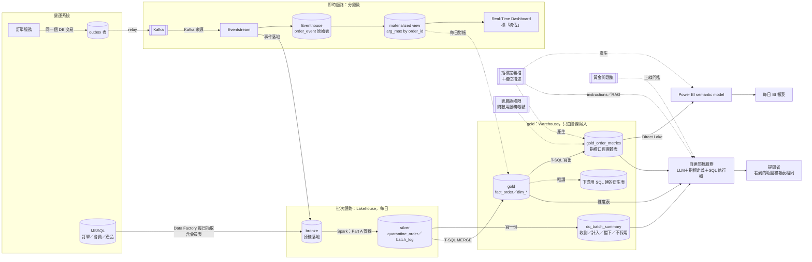

# Part C｜Microsoft Fabric 架構設計：日批 BI、分鐘級儀表板、Text-to-SQL 問數

> **製作說明（2026-10-26 定稿）**：第一版由 AI 在作者不在場時依規劃與官方文件查證寫成（2026-10-19），經 fresh-context 審查修正（`../notes/part_c/review-round1.md`）。2026-10-26 起作者依資料流順序逐題確認：Q1～Q4、Q7、Q10 由作者定案，Q5、Q6、Q8、Q9 採用 AI 建議（`../notes/part_c/tentative-decisions.md`）。製作過程見 `../notes/part_c/process.md`。

**歸屬標註說明**（題目要求 4）：每個 `##` 標一種
- 〔AI 產出〕：AI 寫的，作者還沒改
- 〔AI 產出，使用者修改〕：AI 起草，作者改過內容或做了選擇
- 〔使用者判斷〕：作者自己的經驗判斷，AI 只整理文字

**證據編號**：`F` 開頭是 Fabric 官方文件查證，每條附 learn.microsoft.com 連結與英文原文（`../notes/part_c/fabric-facts.md`）；`E` 開頭是 Part A 的證據，每條附出處檔案與原文（`../notes/part_c/part-a-evidence.md`）。本文在關鍵處直接寫出原意，編號只是讓讀者能查證。

## 目錄
- [1. 名詞〔AI 產出〕](#1-名詞ai-產出)
- [2. 前提與假設〔AI 產出，使用者修改〕](#2-前提與假設ai-產出使用者修改)
- [3. 架構圖〔AI 產出，使用者修改〕](#3-架構圖ai-產出使用者修改)
  - [3.1 日報路線（準，隔天）](#31-日報路線準隔天)
  - [3.2 即時路線（快，分鐘級，初估）](#32-即時路線快分鐘級初估)
  - [3.3 問數路線（可信，隨問隨答）](#33-問數路線可信隨問隨答)
- [4. 元件與分層職責〔AI 產出，使用者修改〕](#4-元件與分層職責ai-產出使用者修改)
- [5. 關鍵取捨〔AI 產出，使用者修改〕](#5-關鍵取捨ai-產出使用者修改)
  - [5.1 bronze／silver 用 Lakehouse，gold 放 Warehouse（ADR-06）](#51-bronzesilver-用-lakehousegold-放-warehouseadr-06)
  - [5.2 即時鏈路用 Eventstream → Eventhouse，不用微批次寫 Lakehouse（ADR-07）](#52-即時鏈路用-eventstream--eventhouse不用微批次寫-lakehouseadr-07)
  - [5.3 語意層：口徑放 gold 實體表，semantic model 建在表上（ADR-08）](#53-語意層口徑放-gold-實體表semantic-model-建在表上adr-08)
- [6. 讓 Text-to-SQL 回答可信的配套〔AI 產出，使用者修改〕](#6-讓-text-to-sql-回答可信的配套ai-產出使用者修改)
  - [6.1 語意層](#61-語意層)
  - [6.2 元資料](#62-元資料)
  - [6.3 權限](#63-權限)
  - [6.4 評估](#64-評估)
- [7. 從 Part A 延續的設計依據〔AI 產出〕](#7-從-part-a-延續的設計依據ai-產出)
- [8. 給上游的改善建議〔使用者判斷〕](#8-給上游的改善建議使用者判斷)
- [9. 未驗證事項與限制〔AI 產出〕](#9-未驗證事項與限制ai-產出)
- [10. AI 與使用者分工總述〔AI 產出〕](#10-ai-與使用者分工總述ai-產出)

## 1. 名詞〔AI 產出〕
跨 Part 共用的業務假設（例如 completed 代表出團完成、amount 是折扣前、晚到的訂單屬於下單那天）見 `../business-assumptions.md`；本節只解釋 Part C 用到的名詞。

| 名詞 | 白話 |
|---|---|
| outbox | 訂單服務寫訂單時，在**同一個資料庫交易**裡多寫一列「待送事件」；另一個程式（relay）再把它送出去。訂單和事件要嘛都寫成、要嘛都沒寫 |
| at-least-once | 「至少送一次」：保證不漏，但同一個事件可能送兩次 |
| Eventstream／Eventhouse／KQL | Fabric 的事件管子／專門存持續進來的事件的資料庫／Eventhouse 的查詢語言 |
| `arg_max(updated_at, *) by order_id` | KQL 寫法：每張訂單只留 updated_at 最大的那一列，也就是最新狀態 |
| Direct Lake | Power BI 直接讀 OneLake 上的 Delta 檔，不用先匯入；要讀實體表才有這個效果 |
| OneLake security | Fabric 在資料層設的權限：哪些人能讀哪些表、哪些列 |
| 撞號 | Part A 發現：增量檔裡的 order_id 已經在 base 出現過，但會員、金額、下單時間都不同，是不同的單用了同一個號碼（ADR-03） |
| 疑似 ×1000 | Part A 發現：40 張訂單金額疑似多乘了 1,000（例如單位錯），只佔 0.04% 訂單卻佔 5～6 月營收 28.09%（E9）。這 40 張留在 fact，人工確認前不計入下游的金額指標（Part A 已定案，`../business-assumptions.md` 3.7「人工確認前，待確認訂單不計入下游的金額指標」） |

## 2. 前提與假設〔AI 產出，使用者修改〕
| 項目 | 假設 | 依據 |
|---|---|---|
| 來源系統 | 訂單、會員、產品在營運 MSSQL；訂單服務可以改程式，加 outbox 表，事件經 Kafka 送進 Fabric | 題目「延續 Part A 的訂單域」；outbox 是作者提出的素材（第 8 節）。〔使用者判斷〕不知道真實業務場景時傾向可擴展的設計；outbox 送出的事件也能推出「現況」，可以做到 Mirroring 的事；應用程式直接送事件出錯的情境太多 |
| 批次量 | demo 資料 base 約 10 萬張、每天約 4,600 列增量；正式環境量級未知 | E2、E3 |
| 即時延遲目標 | 訂單狀態變動後 1～5 分鐘內反映在儀表板 | 題目「分鐘級」 |
| 問數的使用者 | 內部業務與營運人員，以**中文**提問 | 雄獅為台灣公司（假設） |
| 權威數字 | 每日批次的 gold 是唯一權威；即時數字是初估 | 即時層無法處理撞號（5.2） |
| 正式環境補 bronze | 補：上游原始資料原樣落地，訂單事件也落地一份，可重算、可回查撞號 | 〔使用者判斷〕上游不保證能重給。Part A 本機沒有 bronze，是因為原始 CSV 就在 repo 裡（ADR-04） |

## 3. 架構圖〔AI 產出，使用者修改〕

三條路線的關係：日報是唯一的正確答案；即時是「初估」，每天和日報對帳一次；問數讀日報整理好的表。初學者版（含比喻與名詞表）見 `../notes/part_c/three-paths.md`。

### 3.1 日報路線（準，隔天）
| 步驟 | 為什麼需要 |
|---|---|
| Data Factory 每天把 MSSQL 前一天的訂單變動，以及**整張會員表**，搬進 bronze 原樣保存 | 不拖慢營運資料庫；規則改了能重算，撞號要查證時有原件 |
| Part A 管線在 Lakehouse 用 Spark 清理、擋撞號、處理晚到、算匯率、每批對帳，寫進 silver；再用 T-SQL MERGE 寫進 Warehouse 的 gold | 撞號每天約 600 筆、晚到的舊狀態 25 張、晚到新單 60 張（E4～E6），不清理就算錯 |
| 再寫出 `gold_order_metrics`，把折扣前後、異常金額旗標、台北下單日先算好 | 「營收怎麼算」只寫在這裡，報表和問數算出同一個數字（5.3） |
| 全部寫完才 refresh semantic model，Power BI 讀它 | 報表不會看到只更新一半的資料（F5-4） |

### 3.2 即時路線（快，分鐘級，初估）
| 步驟 | 為什麼需要 |
|---|---|
| 訂單服務在寫訂單的同一個交易裡寫 outbox，relay 送進 Kafka | 不會「訂單存了、事件沒送」；Kafka 保證不漏但可能重送 |
| Eventstream 把事件收進 Eventhouse 原始表（只增加不修改），同時落地一份到 Lakehouse bronze（F1-5、F1-7） | 直接查 view 會拿到最新結果，包含還沒整理進 view 的部分（F2-10） |
| materialized view 依 `updated_at` 每張單只留最新狀態 | 擋掉重送與晚到的舊狀態（F1-11、F2-8）；時間相同或時鐘偏差時會取錯，見第 9 節 |
| Real-Time Dashboard 查 view，偵測到新資料就更新（F3-1、F3-2），畫面標「初估」 | 撞號要比對歷史訂單，即時層做不到，數字以次日日報為準並每日對帳 |

### 3.3 問數路線（可信，隨問隨答）
| 步驟 | 為什麼需要 |
|---|---|
| 業務用中文發問，例如「上個月各通路的淨營收？」 | — |
| 問數服務先讀指標定義，知道淨營收用 `net_amount_twd`、要排除 `amount_review` 清單上的單 | AI 最常錯在業務意思，不是 SQL 語法 |
| 對 `gold_order_metrics` 與維度表（例如通路、會員等級）產生 SQL，用問數服務的帳號執行 | 只開放整理好的表，看不到隔離表與原始欄位；能用問數的人看到的範圍和報表相同（6.3） |
| 回答附「這期間有 N 筆訂單被擋下未計入」（讀 `dq_batch_summary`） | 讓人知道數字排除了什麼 |
| 上線前用黃金問題集考試，過門檻才開放（6.4） | 上線前就知道會不會踩 Part A 的已知陷阱 |

## 4. 元件與分層職責〔AI 產出，使用者修改〕
| 元件 | 職責 | 為了哪個需求 |
|---|---|---|
| 訂單服務＋outbox＋relay | 訂單狀態變動和事件在同一個交易產生，不漏；每個事件建立時帶唯一鍵 | 即時 |
| Kafka | 傳遞事件；at-least-once，重送靠下游處理 | 即時 |
| MSSQL | 訂單、會員、產品的營運資料庫，日批的來源 | 日批 |
| Eventstream | 從 Kafka 收事件，同時送進 Eventhouse 與 Lakehouse bronze（F1-1、F1-5、F1-7）；本身沒有去重功能，最多保留 90 天（F1-11） | 即時、可追溯 |
| Eventhouse 原始表＋materialized view | 原始表只 append；view 每張單只留最新狀態，重送與晚到的舊狀態自然被蓋過（F2-8） | 即時 |
| Real-Time Dashboard | 直接查 view，偵測到新資料就更新（F3-1、F3-2）；標「初估，以次日日報為準」 | 即時 |
| Data Factory 每日抽取 | 把 MSSQL 前一天的訂單變動落進 bronze；會員表每天全量抽取，比對前後兩天找出等級變動（第 8 節） | 日批 |
| bronze | 原樣保存上游資料（每日抽取的訂單、會員、產品，以及訂單事件），規則改了能重算、撞號能回查原件；每日的會員表比對前後兩天，就知道等級哪天變動；上游不保證能重給，Kafka 只短期保留 | 日批、可追溯 |
| silver（Part A 管線） | 合約檢查、撞號與晚到處理、隔離表、每批對帳、冪等重跑（ADR-02～05） | 日批、問數 |
| gold（fact／dim，放 Warehouse） | 一張訂單一列最新狀態（ADR-04）、會員 SCD2、產品、日期；只由管線寫入，下游唯讀（ADR-06） | 日批、問數 |
| `gold_order_metrics`（Warehouse） | **指標口徑的唯一實體表**（ADR-08）：每張單一列，帶折扣前後金額、疑似異常旗標、台北下單日等欄位 | 日批、問數 |
| `dq_batch_summary`（Warehouse） | 每批「收到＝計入＋擋下＋不採用」的筆數與資料截止時間（E15）；由管線寫一份進 Warehouse，問數只連一個地方 | 問數 |
| 下游衍生表（Warehouse） | 下游營運人員用 SQL 自己建的彙總表，讀 gold、不改 gold（ADR-06） | 日批 |
| semantic model＋每日 BI 報表 | 讀 `gold_order_metrics`，只做加總與切片，不自己加篩選條件 | 日批 |
| 指標定義檔＋欄位描述 | 一份機器可讀的定義，產生表欄位描述、semantic model 描述、問數 instructions | 問數、日批 |
| 表層級權限 | 問數服務帳號只能讀 gold 指標表、維度表、`dq_batch_summary`；報表與問數看到相同範圍，不設列層級（6.3） | 問數、日批 |
| 自建問數服務 | 讀指標定義檔（RAG）→ LLM 產生 SQL → 檢查唯讀、限制列數 → 用服務帳號執行 → 用中文解釋結果（6.4 之後） | 問數 |
| 黃金問題集 | 上線門檻與回歸測試 | 問數 |
| 提問者 | 內部使用者，登入問數服務後提問，看到的資料範圍和報表相同 | 問數 |

## 5. 關鍵取捨〔AI 產出，使用者修改〕
三個取捨的完整選項、事實與後果在 ADR-06～08。**5.1、5.2 由作者定案；5.3 由作者採用 AI 的建議**。

### 5.1 bronze／silver 用 Lakehouse，gold 放 Warehouse（ADR-06）
- **選項**：全 Lakehouse／gold 放 Warehouse／全 Warehouse
- **事實**：Warehouse 能用 T-SQL 寫入、把多張表的寫入綁成一個交易（F4-4），但鎖整張表，兩個交易改同一張表的不同列也會衝突（F4-5）。Lakehouse 對 SQL 只開放查詢，寫入要用 Spark（F4-1）
- **判斷〔使用者判斷〕**：gold 放 Warehouse。下游營運人員只需要學 SQL，能在 Warehouse 用 SQL 建自己的衍生表
- **〔AI 補充〕gold 對下游唯讀**：管線以 gold 的現況比對每一批新資料，下游手動修改會讓狀態機誤判、被 MERGE 蓋掉、重算時消失；所以 gold 只由管線寫入，下游讀 gold、另建衍生表
- **代價**：資料工程要維護兩種工具（清理用 Spark、寫 gold 用 T-SQL）；Part A 寫 gold 的共用函式 `merge_upsert` 的四個呼叫點要改成 T-SQL；Warehouse 鎖整張表，同一張表的並行寫入會衝突，同一張表的批次要錯開或重試（F4-5）
- **未查證**：Part A 重跑時用 Delta time travel 讀「這批寫入前」的 fact（ADR-05），搬到 Warehouse 後能否沿用；Spark 管線怎麼把資料寫進 Warehouse

### 5.2 即時鏈路用 Eventstream → Eventhouse，不用微批次寫 Lakehouse（ADR-07）
- **從需求推**：分鐘級儀表板要做到兩件事。第一，同一張單的重送與晚到舊狀態，要在進來後幾秒內就被處理掉，否則儀表板會跳動。第二，查詢端要直接讀到剛進來的資料，中間不能再多一段同步
- **選項**：
  - A. Eventstream → Eventhouse → Real-Time Dashboard
  - B. Spark 串流或每分鐘微批次寫 Lakehouse，報表走 Direct Lake
  - C. Eventstream 直接寫 Lakehouse，報表走 Direct Lake
  - D. MSSQL Mirroring 複寫成 Delta 表，報表走 Direct Lake
- **事實**：
  - A 的 materialized view 能在寫入時就取每張單最新狀態，查 view 永遠是最新結果（F2-8、F2-10）；儀表板直接查 Eventhouse（F3-1）
  - Eventhouse 的資料要給 Lakehouse 讀，延遲最少 5 分鐘、預設最多 3 小時（F2-2）。所以**推論**：只要儀表板走 Lakehouse，分鐘級就很難保證
  - B 的 Spark 串流作業自動重啟有 90 天上限，到期要人工重啟（F10-3）
  - C 沒有去重，重送與舊狀態會直接落表
  - D 的變更最快每 15 秒發布到 Delta（F9-5），但產出是資料表不是事件；加上 Direct Lake 後的端到端延遲沒有查證
- **判斷〔使用者判斷〕**：A。多學 KQL，換到省心和秒級（作者選定 AI 提出的對比框架「多學 KQL 換省心／不學新的換自己顧常駐程式」）
- **〔AI 補充〕成本**：兩方案在 Fabric 共用同一份運算容量，資料持續進來時都整天耗用，成本不是決定因素（`../notes/part_c/realtime-cost.md`）
- **〔AI 補充〕和其他選項的差別**：B、C 在寫入當下不處理重送與晚到。D 直接複寫來源表，本來就是最新狀態、也沒有重送問題，和 A 的真正差別在延遲：A 的儀表板直接查 Eventhouse、寫入後就能查，D 接 Direct Lake 後的端到端延遲沒有查證。若實測 D 也在分鐘級，D 不用改上游，是值得重新考慮的選項
- **代價**：取最新狀態的規則要用 KQL 再寫一次，和 Part A 的 PySpark 是兩份。撞號要比對歷史訂單，即時層做不到。所以儀表板標「初估」、以日報為準、每天對帳一次（Part A：撞號每天約 600 筆、晚到 25 張，E4、E5）

### 5.3 語意層：口徑放 gold 實體表，semantic model 建在表上（ADR-08）
- **選項**：全放 semantic model／全放 gold／口徑放 gold、加總與切片放 semantic model
- **事實**：
  - **問數服務是自建的（Q7），只能讀 SQL，讀不到 Power BI 的 DAX 量值**。口徑若只放在 semantic model，問數就得另寫一份
  - 背景：就算改用 Fabric data agent，它查 semantic model 時也會忽略說明文字、不能放範例問答（F6-6、F6-8），能用的 Prep data for AI 還是 Preview（F6-3）
  - Direct Lake 要讀實體表：經 SQL endpoint 的 Direct Lake 遇到沒有實體化的 SQL view，會退回 DirectQuery（F5-5）；直接讀 OneLake 的 Direct Lake 讀的是 Delta 檔，SQL view 不是 Delta 檔（**推論**，文件沒有直接這樣寫）。所以 gold 的口徑要寫成**表**，不能只寫成 view
- **判斷〔AI 產出，使用者修改〕**：採用 AI 建議，口徑放 gold 實體表。作者的理由：「我這裡沒有太多的業務知識，只能選一個作通用的」。AI 的依據：Part A 發現的問題本身是資料品質問題（金額疑似 ×1000、折扣前後混用、「已完成」不等於「已出團」，E8、E9、E11），但**怎麼算**是口徑選擇。這些選擇放在報表與問數都讀同一張表的地方，就只有一份
- **代價**：要守住「semantic model 量值不自己加篩選」，用回歸測試比對兩邊數字

## 6. 讓 Text-to-SQL 回答可信的配套〔AI 產出，使用者修改〕
每項寫「建什麼」與「擋哪種錯」；每類最多三項。

### 6.1 語意層
| 建什麼 | 擋哪種錯 | 連回 Part A |
|---|---|---|
| **指標定義檔**（`metrics.yaml`）：每個指標一筆，寫名稱、同義詞、口徑（用哪個金額欄、排除哪些單、用哪個日期）、對應 SQL；由它產生表欄位描述、semantic model 描述、問數 instructions | 同一個「營收」在報表和問數算法不同 | E8、E9 |
| **`gold_order_metrics` 實體表**：每張單一列，帶 `gross_amount_twd`（折扣前）、`net_amount_twd`（折扣後）、`is_amount_suspect`（在 `amount_review` 人工確認清單上）、`order_date_taipei`、`has_departed`（出發日是否已過）、`order_status`。**營收不含已取消的訂單**（〔使用者判斷〕2026-10-26）。疑似 ×1000 的單：Part A 只定了「40 張留在 fact，人工確認前不計入下游的金額指標」（`../business-assumptions.md` 3.7「人工確認前，待確認訂單不計入下游的金額指標」），金額指標排除 `is_amount_suspect` 為真的列。**營收的完整定義由 Part C 決定**（process-log「營收的定義不在 Part A 決定，移到 Part C 語意層」）。Part A 的 J10 定了 `amount` 欄位存折扣前、另外提供折扣後；營收的定義見 `../business-assumptions.md` 3.9。「營收」沒有指定折扣前後時，**兩個都給**（〔AI 產出，使用者修改〕AI 提出的通用做法，作者選定，2026-10-26）：回答寫明「折扣前 X 元，折扣後 Y 元」 | LLM 挑錯金額欄、用 UTC 日期分組、不知道有異常金額 | E8、E9、E10 |
| **易混名詞表**：寫進 instructions，例如「已完成（completed）不等於已出團，問出團要用 `has_departed`」「問營收沒指定折扣前後時，兩個都給」「營收不含已取消的訂單」 | 字面意思對、業務意思錯 | E11 |

### 6.2 元資料
| 建什麼 | 擋哪種錯 | 連回 Part A |
|---|---|---|
| **欄位描述**：從 Part A 的 `model.md` 欄位表與 `contracts.py` 的值域產生，寫單位、幣別、時區、允許值 | 把原幣別當台幣加總；把狀態值拼錯或亂猜 | E13、E16 |
| **`dq_batch_summary` 表**：每批收到、計入、擋下、不採用的筆數與資料截止時間；問數回答時附上 | 回答看起來精確，其實有幾百筆被擋下，或資料還沒到齊 | E6、E15 |
| **已知限制註記**：寫進 instructions，例如「會員等級精確到天，一天內變動兩次只看得到最後一次」「6 月營收在 7/2 之後還會變」 | 對精度不夠的資料給出過度精確的答案 | E6、E12 |

### 6.3 權限
〔AI 產出，使用者修改〕作者採用 AI 建議（Q8，2026-10-26）：先只做**表層級**權限，問數服務用一個服務帳號查詢。原因是題目沒說雄獅需不需要「不同的人看到不同的訂單」（列層級權限）；不需要的話，表層級最簡單可靠。若業務需要列層級，再升級成「以提問者本人身分查詢」（見表末與第 9 節）。

| 建什麼 | 擋哪種錯 | 依據 |
|---|---|---|
| **問數只開 gold 指標表**：問數服務的帳號在 Warehouse 只被授權讀 `gold_order_metrics`、維度表與 `dq_batch_summary`（管線把 `dq_batch_summary` 也寫一份進 Warehouse，問數只連一個地方） | LLM 查到隔離表或原始欄位的 -1、N/A，算出錯的數字 | E14、E18 |
| **唯讀與結果大小上限**：SQL 執行器用唯讀帳號，執行前檢查只有 SELECT，並限制回傳列數 | LLM 產生寫入語句，或拉走整張表 | — |
| **報表與問數看到的範圍一致**：能用問數的人、能看報表的人，都看到相同的 gold 資料；不設列層級權限 | 問數變成看到「報表看不到的資料」的後門 | — |
| **升級路徑（未做）**：若要列層級，改成以提問者本人身分查詢 Warehouse，用 SQL 的列權限過濾；報表那邊要另外在 semantic model 設列權限，因為 Direct Lake on OneLake 不套用 SQL 列權限（F5-7），且 Warehouse 的 SQL 列權限只在 SQL 連線時生效（F8-10） | 不同部門看到不該看的訂單 | F5-7、F8-10 |

### 6.4 評估
| 建什麼 | 擋哪種錯 | 連回 Part A |
|---|---|---|
| **黃金問題集**：每題有中文問題、預期 SQL、預期答案；刻意收 Part A 的陷阱題（折扣前後、疑似 ×1000、已完成 vs 已出團、台北日） | 上線前不知道它會不會踩到已知的坑 | E8～E11 |
| **回歸測試**：指標定義、表、instructions、模型版本任一改動就重跑整份黃金問題集，低於門檻不上線；自建一支評估程式逐題比對 SQL 執行結果與預期答案；門檻：陷阱題 100% 答對、一般題 90% 以上（〔AI 產出，使用者修改〕作者採用 AI 建議的起點，非查證來的業界標準） | 改了一個定義，別的問題默默變錯 | 同上 |
| **上線後抽樣審查**：每週抽樣回答人工檢查，答錯的題目加進黃金問題集 | 黃金問題集沒涵蓋的新問法 | — |

**問數工具本身〔使用者判斷〕**：自建（LLM＋讀指標定義檔＋SQL 執行器）。作者的理由：「我偏好自己作」。〔AI 補充〕Fabric data agent 的限制：官方寫明目前不支援非英文、回答最多 25 列、不能換模型（F7-8）；自建可以處理中文、自選模型，代價是權限傳遞、SQL 安全、評估與維運都要自己做。上面的配套都以自建為前提。

## 7. 從 Part A 延續的設計依據〔AI 產出〕
- **引擎**：Part A 選 PySpark＋Delta，就是為了在 Fabric 不用重寫（ADR-01）→ 清理沿用 Spark 在 Lakehouse 跑，gold 寫進 Warehouse 時只改寫入那一層（5.1）
- **資料品質**：撞號每天約 600 筆、晚到 25 張（ADR-03、E4、E5）→ 即時層只能取最新狀態，撞號留給日批，即時標初估（5.2）
- **對帳**：「收到＝計入＋擋下＋不採用」（E15）→ `dq_batch_summary`，問數回答附排除筆數（6.2）
- **會被問錯的定義**：折扣前後、疑似 ×1000、已完成 vs 已出團、台北日、會員月快照（E8～E12）→ 指標實體表、易混名詞表、黃金問題集的陷阱題（6.1、6.4）
- **schema 合約**（ADR-02）→ 欄位描述的來源（6.2）

## 8. 給上游的改善建議〔使用者判斷〕
素材是作者在 Part A 討論時提出的（原文見 `../notes/part_c/user-material.md`），AI 只整理文字。這兩項是第 3 節架構圖「來源」那一側的前提。
- **訂單事件：Kafka 放在 outbox 後面**。訂單服務在寫訂單的同一個資料庫交易裡寫一列 outbox，再由 relay 送進 Kafka，所以「訂單寫了、事件沒送」不會發生。Kafka 預設 at-least-once，重送擋不掉，所以每個事件在建立時就產生唯一鍵，下游靠它冪等寫入。〔AI 補充：對應到本設計，即時層的 `arg_max` 與日批的 MERGE 都是這種冪等寫入〕
- **會員變動時間**：上游只給每月快照，SCD2 的生效日只能用快照日近似（E12）。〔使用者判斷〕不改上游，也不開 CDC：日批每天把會員表原樣抽進 bronze，比對前後兩天就知道哪一天變動，精確到天就夠，不用承擔 CDC 的風險。〔AI 補充〕曾考慮資料庫 CDC（每次變動、到秒），成本分析發現 capture job 停擺或長交易時，營運資料庫的 transaction log 會截不掉而一直長大（`../notes/part_c/cdc-cost.md`），所以改用每日比對。代價：一天內變動兩次只看得到最後一次；「精確到天」的前提已查證：雄獅官方規則以「日」為單位，升等後等級效期自當天起重新計算一年，沒有用到時分秒（`../notes/part_c/lion-member-tier-rules.md`）。比對時除了等級，也要比對效期欄位，否則「續等」（等級不變、效期延長）會看不到

## 9. 未驗證事項與限制〔AI 產出〕
- **gold 放 Warehouse 的兩個未查證事項**（ADR-06）：Part A 重跑用的 Delta time travel 在 Warehouse 能否沿用；Spark 管線怎麼把資料寫進 Warehouse
- **Fabric 上未實測**：本設計沒有在 Fabric 上跑過；Part A 只在本機用 PySpark＋Delta 模擬 Lakehouse。Delta time travel 在 Fabric 的行為是依格式推論（ADR-05）
- **產品狀態有矛盾或沒明確 GA**：data agent 的說明頁寫 GA，但 Fabric 的 AI 功能狀態總表把它和其他 Preview 功能合併成一列標 Preview；Direct Lake on OneLake 與 OneLake security 只能說「官方現行文件沒標 Preview」，找不到 GA 宣告
- **Preview 功能**：Prep data for AI（F6-3）
- **分鐘級沒有實測**：Real-Time Dashboard 的更新間隔下限，官方文件沒給數字；Mirroring＋Direct Lake 的端到端延遲也沒查證
- **自建問數的未知數**：LLM 對中文業務問題產生 SQL 的正確率要靠黃金問題集實測；若之後要列層級權限，提問者身分怎麼帶到 Warehouse 查詢，沒有查證（6.3）
- **`arg_max` 依賴上游時間可信**：同一張單兩個事件的 updated_at 相同、或上游時鐘有偏差時，取到的不一定是真的最新狀態。對策是上游給每個事件帶遞增版本號，改用版本號取最新（Part A 給上游的建議已包含「狀態帶版本號」，E18）
- **權限只做到表層級**（Q8 採用 AI 建議）：雄獅是否需要列層級權限未知。Direct Lake 官方建議用固定身分連線（F5-8），若之後要列層級，報表與問數都要另外設計（6.3）
- **即時層不處理撞號**：即時數字和日報一定有差，靠每日對帳說明差異，不保證一致

## 10. AI 與使用者分工總述〔AI 產出〕
〔AI 產出〕作者指示 AI 依過程紀錄撰寫本節（2026-10-26：「你幫我收尾」），作者尚未改寫。

本設計的骨架、Fabric 官方文件查證（`fabric-facts.md` 85 條，另有 CDC 成本、即時方案計費、雄獅會員規則三份查證）、架構圖與本文件由 AI 產出，並經多輪 fresh-context agent 審查；審查抓到的 AI 錯誤包括 Power BI 用 Direct Lake 讀 SQL view（F5-5）、權限混用兩種互斥模式、以及把 AI 的理由標成作者判斷，都已修正。作者依資料流順序逐題確認：outbox＋Kafka（Q1）、補 bronze 並讓事件落地（Q2）、gold 放 Warehouse 讓下游用 SQL 建衍生表（Q3）、即時用 Eventhouse（Q4）、自建問數服務（Q7）、營收不含已取消的訂單是作者自己的判斷；會員變動時間（Q10）由作者先選 CDC，看完成本分析後自己發現有了每日 bronze 就不需要 CDC，改成每日比對。作者業務知識不足的題目（Q5 即時與日報的差異、Q6 語意層位置、Q8 權限、Q9 及格線、營收折扣前後兩個都給）採用 AI 建議，相關段落標〔AI 產出，使用者修改〕。每題的選項、原話與時間見 `../notes/part_c/tentative-decisions.md` 與 `../notes/part_c/process.md`，有取捨的三題見 ADR-06～08。
